# Blocs réguliers non conformes recollés par pénalité intérieure : mathématiques et implémentation

État au 12 novembre 2026. Bibliothèque : `makutu/mortar/` ; applications, exemples et ce document :
`apps/mortar/` (FUnTiDES-App, branche `makutu`) ; solveur SEM 2-D de
FUnTiDES (branche `dev-2d`). Commits : FUnTiDES-App `69643bb` (branche `makutu`), FUnTiDES `4e001b9` (branche `dev-2d`, installé
dans `FUnTiDES-install`).

## 1. Point d'étape

**Ce qui est acquis (acoustique 2-D, modélisation).**

- Le domaine est pavé de blocs rectangulaires réguliers. L'ordre polynomial $N$ et le nombre de points par
  longueur d'onde (ppw) sont fixés ; la taille des mailles de chaque bloc découle de la vitesse et de la
  fréquence : $h = N v / (f_{\max}\,\mathrm{ppw})$, $f_{\max} = 2{,}5\, f_0$. Aucun élément n'est déformé.
- Les blocs ne partagent aucun nœud. Ils sont recollés par une pénalité intérieure symétrique (SIPG),
  pour un rapport de tailles quelconque.
- Le schéma est validé : énergie conservée à 1e-15, solution exacte 2-D reproduite à mieux que 3e-3 à
  travers 9 blocs non conformes, surface libre, 8 s simulées sans croissance.
- L'erreur propre aux interfaces est négligeable à 5 et 6 ppw : les coefficients de réflexion et de
  transmission d'une onde plane sont exacts à 2e-3 près pour des contrastes de 0,25 à 4.
- Le tout tourne dans FUnTiDES sur GPU et dans le solveur acoustique de makutu. FUnTiDES (float32)
  reproduit le prototype (float64) à 1e-6 près.
- Sur Sigsbee, les blocs demandent 37 712 éléments contre 67 840 pour la grille uniforme, et un pas de
  calcul GPU de 0,13 ms contre 0,26 ms.

**Limites connues.**

- Un bloc prend la plus petite taille requise dans tout son rectangle : 1,16 fois le nombre idéal
  d'éléments sur Sigsbee, 1,4 fois sur Marmousi.
- Les bords courbes nets (sel) sont suivis en escalier, comme sur toute grille cartésienne.
- Un seul ordre polynomial pour tous les blocs.
- Acoustique 2-D seulement ; pas d'élastique, pas de 3-D, pas de MPI.

**Abandonné.** Le pas de temps propre à chaque bloc (LTS) : stable après promotion des éléments
d'interface et gradation des niveaux, mais sans gain au pas que demande la précision (section 8).

**Suite engagée.** Prototype hybride (section 9) : triangles en Galerkin discontinu le long des interfaces
du modèle, SEM continu sur grilles régulières ailleurs, ordre propre à chaque zone SEM.

## 2. Problème continu et forme faible

Équation des ondes acoustiques en pression, dans $\Omega$, de masse volumique $\rho$ et de vitesse $v$ :

$$
\frac{1}{\rho v^2}\,\frac{\partial^2 p}{\partial t^2} - \nabla\cdot\left(\frac{1}{\rho}\,\nabla p\right) = f .
$$

$\Omega$ est partagé en blocs $\Omega_k$. On note $\Gamma$ la réunion des interfaces entre blocs,
$\mathbf{n}$ la normale unitaire à $\Gamma$ orientée du bloc $A$ vers le bloc $B$, et

$$
[u] = u_A - u_B \quad\text{(saut)}, \qquad \{q\} = \tfrac{1}{2}\,(q_A + q_B) \quad\text{(moyenne)} .
$$

On cherche $p$ dans l'espace $V_h$ des fonctions continues dans chaque bloc (polynômes de degré $N$ par
direction sur chaque élément) et discontinues entre blocs. Pour toute fonction test $w$ de $V_h$ :

$$
m\!\left(\frac{\partial^2 p}{\partial t^2}, w\right) + c\!\left(\frac{\partial p}{\partial t}, w\right) + a(p, w) = (f, w),
$$

$$
m(u, w) = \sum_k \int_{\Omega_k} \frac{u\,w}{\rho v^2},
$$

$$
a(u, w) = \sum_k \int_{\Omega_k} \frac{1}{\rho}\,\nabla u\cdot\nabla w
 - \int_\Gamma \left\{\frac{1}{\rho}\frac{\partial u}{\partial n}\right\}[w]
 - \int_\Gamma \left\{\frac{1}{\rho}\frac{\partial w}{\partial n}\right\}[u]
 + \int_\Gamma \gamma\,[u]\,[w],
$$

$$
c(u, w) = \int_{\partial\Omega_{\mathrm{abs}}} \frac{u\,w}{\rho v} \qquad\text{(condition absorbante du premier ordre)} .
$$

Le deuxième terme de $a$ vient de l'intégration par parties dans chaque bloc (consistance) ; le troisième
le symétrise ; le quatrième pénalise le saut. La forme $a$ est symétrique, et coercive si $\gamma$ est
assez grand. Les bords extérieurs sans condition portent la condition naturelle (paroi rigide) ; la
surface libre impose $p = 0$.

## 3. Discrétisation

**Dans un bloc** : éléments spectraux continus. Bloc $[x_0, x_1] \times [z_0, z_1]$ découpé en
$n_x \times n_z$ rectangles de taille $h_x \times h_z$ ; sur chaque élément, base de Lagrange $\ell_j$ aux
$(N+1)^2$ points de Gauss-Lobatto-Legendre (GLL) $\xi_i$, qui servent aussi de points de quadrature. Avec
les poids $w_a$, la matrice de dérivation $D_{ij} = \ell_j'(\xi_i)$ et les propriétés lues aux nœuds :

$$
M_{ab} = \frac{h_x h_z}{4}\,\frac{w_a w_b}{(\rho v^2)_{ab}} \qquad\text{(masse, diagonale)},
$$

$$
K^x_{(a,b),(a',b')} = \delta_{bb'}\,\frac{h_z}{h_x} \sum_c D_{ca}\, w_c w_b \left(\frac{1}{\rho}\right)_{cb} D_{ca'} \qquad\text{(raideur en } x\text{)},
$$

et de même en $z$. Les contributions des éléments d'un bloc sont assemblées sur ses nœuds.

**Sur une interface** : les arêtes d'éléments des deux côtés découpent l'interface en segments ; chaque
segment est l'intersection d'une arête de $A$ et d'une arête de $B$. Sur un segment de longueur $L$, on
intègre avec $N+1$ points de Gauss-Legendre $s_q$ (poids $\omega_q$), ce qui est exact pour les produits
de deux polynômes de degré $N$. En un point $s_q$, pour le côté $c \in \{A, B\}$ :

$$
u_c(s_q) = \sum_b \ell_b(\eta_q^c)\, u^c_b \qquad\text{(trace, nœuds de la face)},
$$

$$
\frac{\partial u_c}{\partial n}(s_q) = \frac{2}{h_n^c} \sum_b \ell_b(\eta_q^c) \sum_a D_{fa}\, u^c_{ab} \qquad\text{(dérivée normale)},
$$

où $\eta_q^c$ est la coordonnée de référence de $s_q$ le long de l'arête de $c$, $h_n^c$ la taille de
l'élément dans la direction normale et $f$ l'indice de la face ($N$ du côté $A$, $0$ du côté $B$). Le
rapport des tailles n'intervient que par $\eta_q^c$ : il est quelconque.

**Pénalité.**

$$
\gamma = \alpha\,(N+1)^2\,\frac{\max(1/\rho_A,\ 1/\rho_B)}{\min(h_n^A,\ h_n^B)}, \qquad \alpha = 1{,}25\,\frac{N}{2\,(N+1)} .
$$

$N(N+1)/2$ est la constante de l'inégalité de trace des points GLL ; le facteur 1,25 est une marge. La
coercivité mesurée (plus petite valeur propre positive ou nulle) demande $\alpha \ge 0{,}22$ / $0{,}32$ /
$0{,}37$ aux ordres 2 / 4 / 6. Toute pénalité au-delà réduit le pas de temps : une interface conforme
coûte 8 % du pas à l'ordre 4 avec $\alpha$ par défaut, 37 % avec $\alpha = 1$.

**Système discret.** Avec le vecteur $u$ des valeurs nodales de tous les blocs :

$$
M\,\frac{u^{n+1} - 2u^n + u^{n-1}}{\Delta t^2} + C\,\frac{u^{n+1} - u^{n-1}}{2\,\Delta t} + K u^n = F^n ,
$$

$M$ et $C$ diagonales, $K = K_{\mathrm{blocs}} + K_\Gamma$ symétrique. Sans amortissement ni source,
l'énergie discrète

$$
E^{n+1/2} = \frac{1}{2} \left(\frac{u^{n+1} - u^n}{\Delta t}\right)^{\!T} M \left(\frac{u^{n+1} - u^n}{\Delta t}\right) + \frac{1}{2}\,(u^{n+1})^T K\, u^n
$$

est conservée. Le schéma est stable si

$$
\Delta t < \frac{2}{\sqrt{\lambda_{\max}(M^{-1} K)}} ;
$$

`Mortar2D.dt_max()` calcule cette borne exactement.

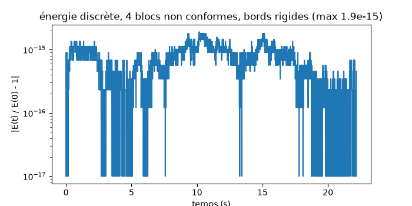

## 4. Pavage : choix des blocs

Taille requise par cellule du modèle SEP : $h_{\mathrm{req}} = N v / (f_{\max}\,\mathrm{ppw})$. Un bloc $R$
de largeur $W$ et de hauteur $H$ est maillé par $\lceil W/h \rceil \times \lceil H/h \rceil$ éléments avec
$h = \min_R h_{\mathrm{req}}$ : tous ses éléments respectent le critère.

Le pavage minimise le coût par programmation dynamique sur un arbre de coupes binaires (indices de
cellules SEP) :

$$
\mathrm{coût}(R) = \min\Big( \mathrm{feuille}(R),\ \min_{\text{coupes } R = R_1 \cup R_2} \big[\mathrm{coût}(R_1) + \mathrm{coût}(R_2)\big] \Big),
$$

$$
\mathrm{feuille}(R) = n_x n_z + \frac{\lambda}{2}\, n_{\mathrm{int}}(R),
$$

où $n_{\mathrm{int}}(R)$ est le nombre d'arêtes d'éléments de $R$ situées sur des interfaces intérieures et
$\lambda$ le poids d'interface.

- Coupes essayées : le milieu selon x et selon z, plus les bords nets locaux (saut relatif de vitesse
  supérieur à 10 % sur au moins la moitié du rectangle), au plus deux par direction.
- Le modèle est d'abord coupé en tranches sur les interfaces horizontales nettes.
- Un rectangle traversé par un saut supérieur à 30 % ne peut pas rester un seul bloc.
- Poids d'interface : $\lambda = 2$ éléments par arête d'interface (coût mesuré sur GPU).
- Pas de temps d'un bloc : $\Delta t = C \min(h_x, h_z) / v_{\max}$, $C = 0{,}1044$ à l'ordre 4.
  `plan_blocks_global` retient, parmi plusieurs pas globaux visés, le pavage de moindre travail
  (éléments / pas).

Lecture du modèle aux nœuds : interpolation bilinéaire des valeurs placées aux centres des cellules
SEP. Sur un bord de bloc où le modèle saute de plus de 10 %, les nœuds lisent le modèle à une
demi-cellule à l'intérieur de leur bloc : le saut est exact, chaque côté voit son milieu.

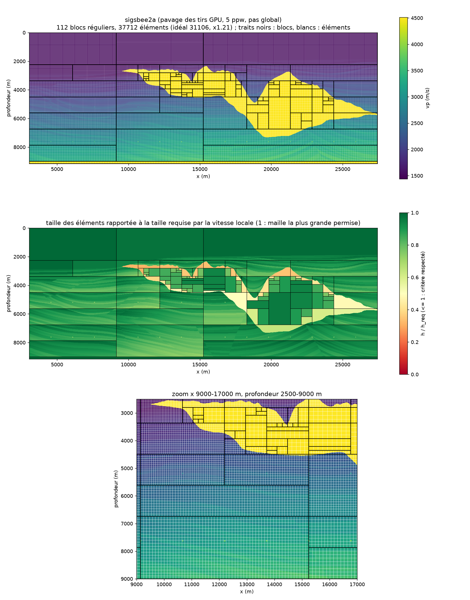
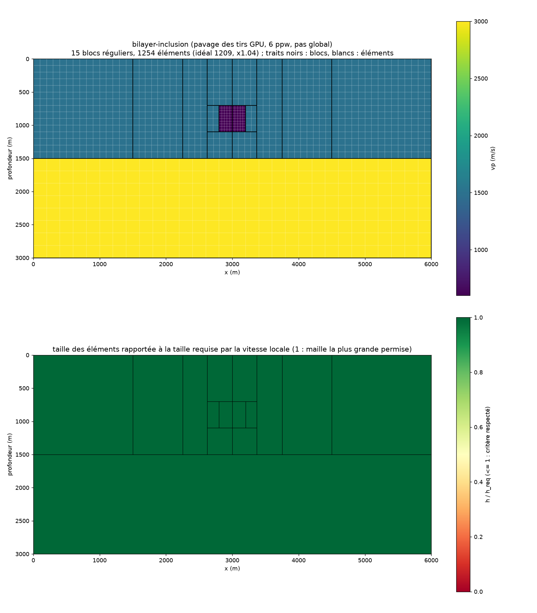

| modèle (ordre 4, 5 ppw, f0 = 8 Hz) | idéal | blocs | grille uniforme |
|---|---|---|---|
| Sigsbee 2A | 31 106 | 37 712 (112 blocs) | 67 840 |
| Marmousi | 3 513 | 5 220 (27 blocs) | 9 686 |
| seg2d | 1 704 | 2 610 (10 blocs) | 3 698 |
| bicouche + inclusion (ordre 2, 6 ppw) | 1 209 | 1 254 (15 blocs) | 11 250 |

## 5. Implémentation

### 5.1 Prototype Python (`makutu/mortar/`, NumPy / SciPy, sans GPU)

| fichier | contenu |
|---|---|
| `solver2d.py` | `Patch` (bloc), `Mortar2D` : numérotation, masse, raideur creuse, interfaces, bords, `dt_max`, `run` ; `interface_faces()` produit les tableaux du noyau FUnTiDES |
| `blocks2d.py` | `plan_blocks`, `plan_blocks_global`, `uniform_plan`, `grid_sampler`, `sharp_interfaces`, `gll_cfl` |
| `funtides2d.py` | `funtides_model` (ModelUnstruct 2-D à nœuds dupliqués), `set_interface_operator`, `FuntidesBlocks2D` (tir direct, `dt_max` par itération de puissance sur GPU) |
| `mesh2d.py` | `BlocksMesh2D` : maillage pour `AcousticSolver` de makutu (localisateur, crochet `solver_setup`) |
| `plots2d.py` | figures des pavages |
| `lts2d.py` | prototype de pas de temps par bloc (abandonné) |
| `hybrid2d.py`, `hybrid_plan.py` | hybride SEM + triangles DG (§ 9) |

Applications (`apps/mortar/`) : `hybrid_compare_2d.py`, `mesh_cost_2d.py`, `hybrid_disk_2d.py`,
`interface_error_study.py` (avec `interface_study.py` : onde plane sur une interface), `blocks_shots_2d.py`,
`blocks_convergence_2d.py` ; `reproduce.py` relance les modélisations du registre `cases.py` et contrôle
les valeurs obtenues.

Numérotation : les nœuds d'un bloc sont numérotés ligne par ligne, les blocs à la suite. Un nœud
géométrique situé sur une interface existe une fois par bloc.

### 5.2 FUnTiDES (`SEMsolver2D`, branche dev-2d)

- `Solver::setInterfaceOperator(face, line, dn, lag, half_inv_rho, weight, gamma, n_q)`. Par segment $s$
  et par côté $c$ : `face` (nœuds de la face), `line` (pour chaque nœud de face, les $N+1$ nœuds de la
  ligne d'élément normale à la face), `dn` (coefficients de la dérivée normale sur cette ligne), `lag`
  (base de Lagrange de la face aux points de Gauss, $\ell^c_{qb}$), `half_inv_rho`
  ($r^c_q = \tfrac{1}{2}(1/\rho)$ aux points), `weight` ($W_q = \omega_q L / 2$), `gamma`.
- Noyau, un fil par segment. Traces $t^c_b$ et dérivées normales $d^c_b$ aux nœuds de face ; aux points de
  Gauss, saut et flux moyen

  $$
  J_q = \sum_b \ell^A_{qb}\, t^A_b - \sum_b \ell^B_{qb}\, t^B_b, \qquad F_q = \sum_{c} r^c_q \sum_b \ell^c_{qb}\, d^c_b ;
  $$

  le vecteur des forces reçoit, pour chaque fonction test $w$,

  $$
  \sum_q W_q \Big( (\gamma J_q - F_q)\,[w]_q - J_q\,\{w\}_q \Big),
  $$

  réparti sur les nœuds de face et les lignes normales par ajouts atomiques.
- Coût mesuré sur Sigsbee (4 663 segments) : 0,024 ms par pas. Deux variantes ont été écartées : lignes
  pleines sur tous les nœuds des deux éléments (0,106 ms), une équipe Kokkos par segment (0,187 ms).
- Amortissement des bords : une arête d'un seul élément qui contient un nœud intérieur est une arête
  d'interface et n'est plus amortie.
- `FieldSampler` : sommes pondérées aux récepteurs sur le GPU (392 récepteurs : 0,019 ms par pas).
- Construction et tests d'un arbre de construction qui partage son préfixe d'installation :
  `scripts/dev/build_tree_env.sh`.

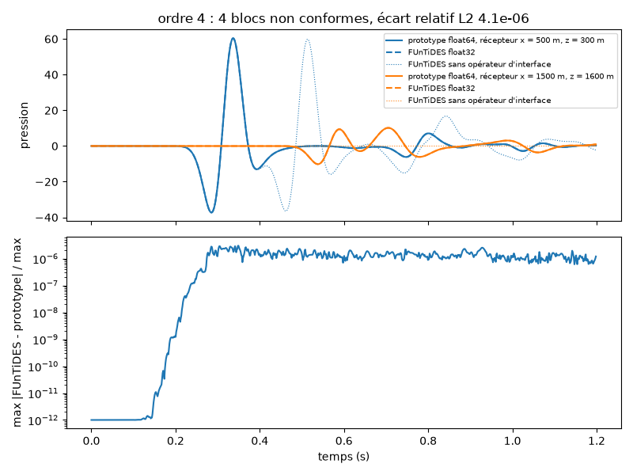

### 5.3 makutu

`BlocksMesh2D(vp_file, f0=...)` construit le pavage, le maillage et le modèle FUnTiDES ;
`solver_kwargs()` donne à `AcousticSolver` le modèle, le localisateur des sources et récepteurs et le
crochet `solver_setup`, qui pose l'opérateur d'interface après chaque `compute_fe_init`.

## 6. Validation

| contrôle | résultat | test |
|---|---|---|
| K symétrique, semi-définie positive | oui, ordres 2 et 4 | `test_mortar2d.py` |
| énergie, 4 blocs, rapports 1,37 à 3,5, contrastes | dérive < 1e-10 | `test_mortar2d.py` |
| solution exacte 2-D, 9 blocs, rapports 1,15 à 1,9, ordres 2 à 4, source sur un coin | < 3e-3 | `test_mortar_modeling_validation.py` |
| surface libre, couches, contre grille fine | 2,6 % | idem |
| 8 s simulées | pas de croissance | idem |
| FUnTiDES contre prototype | 1e-6 | `test_mortar_funtides.py` |
| tir `AcousticSolver` contre tir direct | 1,4e-5 | `test_mortar_makutu_solver.py` |

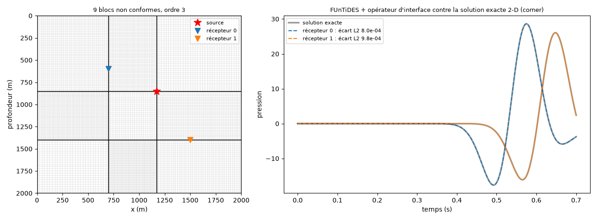
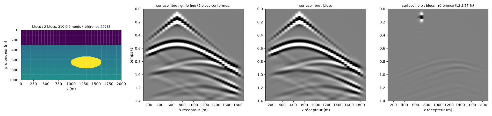

**Erreur due aux interfaces** (onde plane en incidence normale, ordre 4, contraste $c = v_2 / v_1$ égal au
rapport des tailles). Erreur sur les coefficients de réflexion $R$ et de transmission $T$, dont les valeurs
exactes sont $R = (Z_2 - Z_1)/(Z_2 + Z_1)$ et $T = 1 + R$ avec $Z = \rho v$ ; blocs contre maillage
conforme à la plus petite taille :

| ppw | blocs, $\lvert R - R_{\mathrm{exact}}\rvert$ | conforme | blocs, $\lvert T - T_{\mathrm{exact}}\rvert$ | conforme |
|---|---|---|---|---|
| 4 | 1,5e-3 à 1,1e-2 | 5e-4 à 1,3e-2 | 3e-3 à 2,6e-2 | 5e-4 à 1,8e-2 |
| 5 | 2e-4 à 1,7e-3 | 6e-4 à 2,2e-3 | 4e-5 à 3,8e-3 | 6e-5 à 2,2e-3 |
| 6 | 9e-6 à 2,8e-4 | 1,5e-4 à 3,6e-4 | 2e-5 à 7,9e-4 | 1e-4 à 4e-4 |

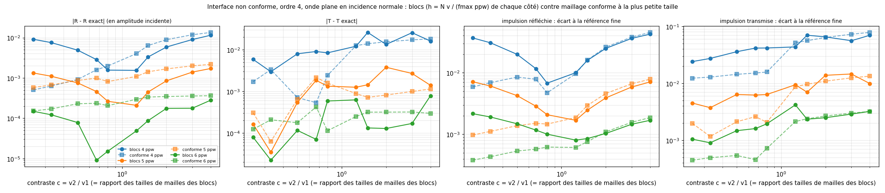

**Tirs GPU.** Sigsbee, 6 s simulées : blocs 5 ppw 1,0 s de calcul, grille uniforme 1,5 s.

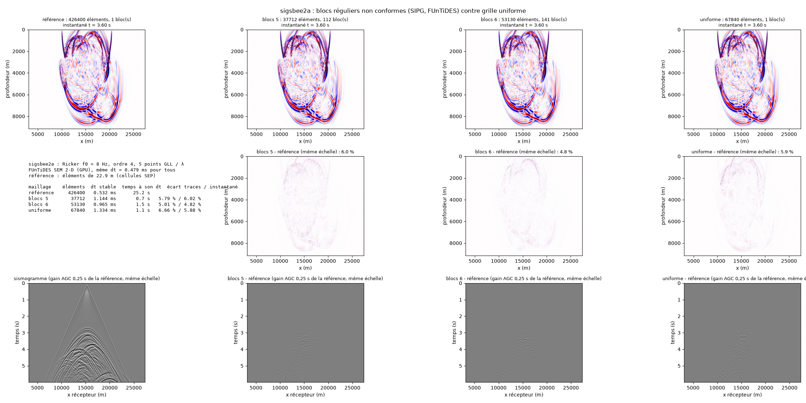

## 7. Lecture du modèle et références

Un modèle SEP se lit « en marches » (constant par cellule) ou « lissé » (interpolation bilinéaire). Les
traces des deux lectures diffèrent de 2 % (bicouche) à 8 % (Sigsbee). Une comparaison n'a de sens que
contre une référence qui lit le modèle comme le maillage testé.

- Bicouche, contre la référence en marches (un élément par cellule) : blocs 1,9 / 0,85 / 0,34 / 0,12 %
  à 6 / 7 / 9 / 12 ppw ; grille uniforme non alignée sur l'inclusion 14 % / 7,1 % à 6 / 9 ppw.
- Sigsbee, contre la référence lissée à une cellule (3,8 millions d'éléments) : blocs 5,1 / 3,9 / 2,7 /
  2,4 % de 5 à 8 ppw ; grille uniforme 5,6 / 2,4 % à 5 / 7 ppw.

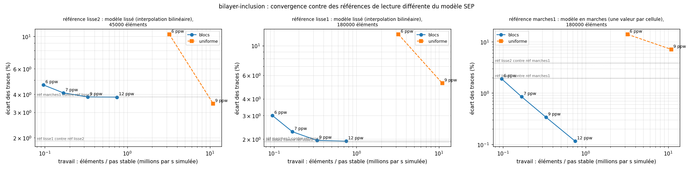
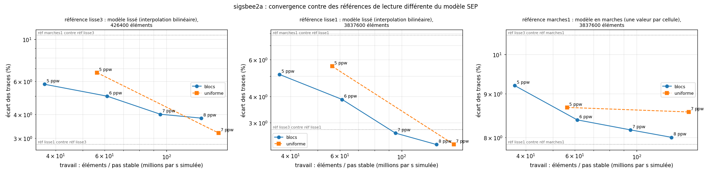

## 8. Pas de temps par bloc (abandonné)

Schéma de Diaz et Grote appliqué niveau par niveau (bloc de niveau $l$ : pas $\Delta t / 2^l$), version stabilisée
de Grote, Michel et Sauter. Deux conditions de stabilité ont été établies par la mesure : les éléments
des deux côtés d'une interface prennent le niveau le plus fin des deux blocs, et deux nœuds couplés
diffèrent d'un niveau au plus. Au pas que demande la précision, le gain est nul sur Marmousi et de 4 à
14 % sur Sigsbee : non porté dans FUnTiDES.

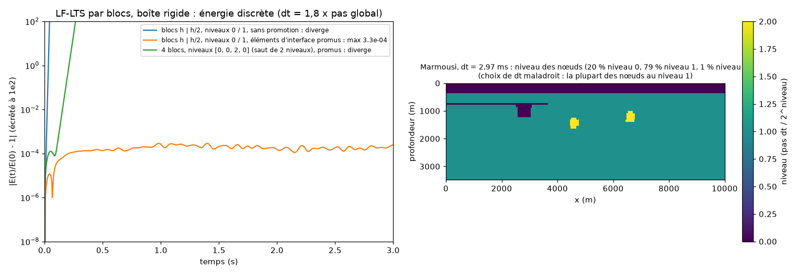

## 9. Prototype hybride : SEM régulier + triangles DG (`hybrid2d.py`)

**Principe.** Les grilles régulières SEM restent la règle ; leur taille suit la vitesse et la fréquence.
Le Galerkin discontinu est réservé aux changements du modèle :

- **zones SEM** (`QuadZone`) : grille régulière, ordre $N$ propre à la zone. L'ordre change d'une zone à
  l'autre (p-adaptivité), ce qui est possible parce que les zones ne se touchent que par des faces DG ;
- **zones de triangles** (`TriZone`) : une bande le long d'une interface courbe, dont les arêtes suivent
  le contour. Galerkin discontinu d'ordre $p = 3$, base modale orthonormée de Koornwinder-Dubiner
  $\psi_i$ sur le triangle de référence : la masse reste diagonale,

  $$
  M_e = \frac{|K_e|}{2}\,\frac{1}{\rho_e v_e^2}\, I, \qquad
  K_e = \frac{|K_e|}{2}\,\frac{1}{\rho_e} \int_{\hat K} \nabla\psi_i\cdot\nabla\psi_j ,
  $$

  avec $|K_e|$ l'aire du triangle et des propriétés constantes par triangle ;
- **couplage** : la même forme SIPG (section 2) sur toutes les faces entre zones et sur toutes les arêtes
  entre triangles. De chaque côté, on évalue la trace et la dérivée normale de la base de l'élément aux
  points de Gauss du segment ($\max(p_A, p_B) + 1$ points). Les bords de zones sont alignés sur les
  axes ; les arêtes des deux côtés se correspondent de façon quelconque.

**Pénalité.**

$$
\gamma = \max_{c \in \{A, B\}} \frac{\kappa_c}{\rho_c}, \qquad
\kappa_{\mathrm{rect}} = 1{,}25\,\frac{N(N+1)}{2\,h_n}, \qquad
\kappa_{\mathrm{tri}} = \tau\,\frac{(p+1)(p+2)}{2}\,\frac{|e|}{|K_e|},
$$

où $|e|$ est la longueur de l'arête (inégalité de trace de Warburton et Hesthaven) et $\tau = 0{,}5$.
Seuil de coercivité mesuré : $\tau \approx 0{,}32$.

**Pas de temps.** Celui des triangles dépend de leur plus petit rayon inscrit, de l'ordre et de $\tau$. Le
contour doit être discrétisé à la taille des triangles et les bords divisés uniformément
(`triangulate_ring`), sinon des triangles aplatis divisent le pas par 3. Avec l'ordre 3 et des arêtes de
la taille des mailles SEM, la bande de triangles tient 55 à 65 % du pas du SEM.

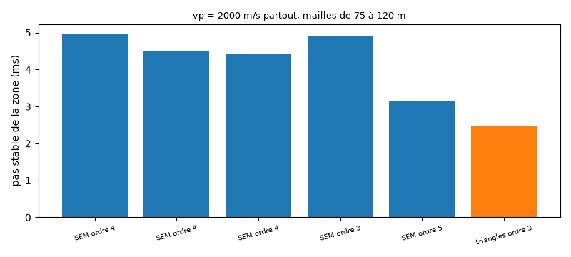

**Validation** (`tests/unitTests/test_hybrid2d.py`, 9 tests).

| contrôle | résultat |
|---|---|
| base de Dubiner orthonormée, dérivées | 1e-12, 1e-6 |
| K symétrique, semi-définie positive, énergie (SEM d'ordres 3, 4, 5 + triangles, contraste) | dérive 1e-14 |
| solution exacte 2-D à travers SEM d'ordres 3, 4, 5 et triangles | 0,6 à 1,2 % (plancher du SEM à 5 ppw) |

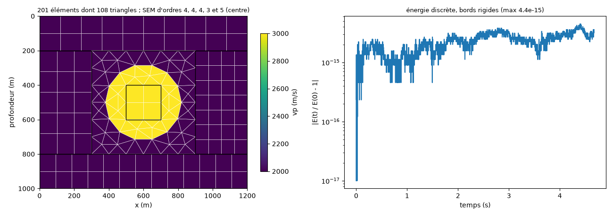
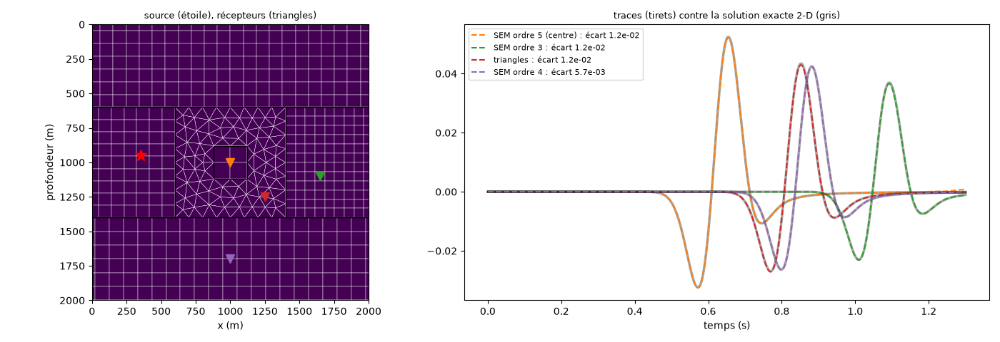

**Disque rapide** (4000 m/s dans 2000 m/s, f0 = 8 Hz, 5 ppw ; `apps/mortar/hybrid_disk_2d.py`),
écarts à une référence hybride 2,5 fois plus fine :

| maillage | éléments | inconnues | pas stable | traces | instantané |
|---|---|---|---|---|---|
| hybride (SEM 4 et 6, 536 triangles) | 2 116 | 31 501 | 1,37 ms | 1,1 % | 1,7 % |
| blocs en escalier / grille uniforme | 1 900 | 30 753 | 2,08 ms | 4,6 % | 7,8 % |

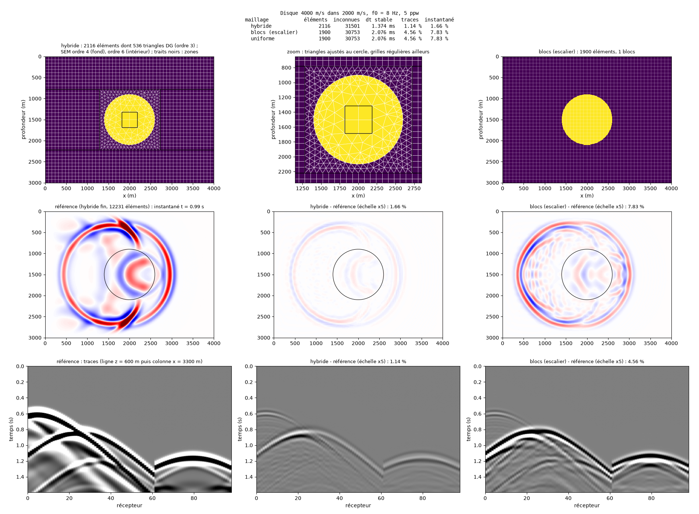

**Propriétés variables dans les triangles.** Avec une vitesse constante par triangle, lue en son centre, les
triangles de 100 à 190 m lissent grossièrement les gradients et les cellules de transition : sur seg2d,
22 % d'écart sur les traces. Les propriétés sont donc lues aux points de quadrature :

$$
M_e = \frac{|K_e|}{2} \sum_q \hat w_q\, \frac{\psi_i(\hat x_q)\,\psi_j(\hat x_q)}{\rho_q v_q^2}, \qquad
K_e = \frac{|K_e|}{2} \sum_q \hat w_q\, \frac{\nabla\psi_i\cdot\nabla\psi_j}{\rho_q} .
$$

La masse n'est plus diagonale mais diagonale par blocs (un bloc $10\times 10$ par triangle à l'ordre 3,
inversé une fois) : le schéma reste explicite et l'énergie est conservée (2,6e-15).

**Zones automatiques** (`hybrid_plan.py`, `plan_hybrid`), à partir d'un modèle SEP :

1. corps à bord net (par défaut : vitesse supérieure à 95 % du maximum), contour lissé (indicatrice
   filtrée, niveau 1/2) : c'est l'interface que suivent les arêtes des triangles ;
2. bande de triangles : tuiles d'une grille grossière à moins de 0,75 taille de triangle du contour ;
3. reste du domaine : plus grands rectangles de tuiles libres, chacun pavé par `plan_blocks`
   (h = N v / (f_max ppw)), ordre propre aux zones à l'intérieur des corps ;
4. chaque zone lit le modèle de son côté du contour (modèle prolongé par plus proche voisin) : le saut est
   porté par les arêtes des triangles, jamais par l'intérieur d'un élément.

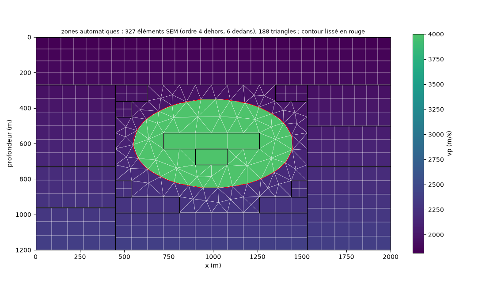

**seg2d** (f0 = 8 Hz, 5 ppw ; `apps/mortar/hybrid_compare_2d.py`), modèle commun (sel délimité par le
contour lissé), écarts à une référence hybride 2,5 fois plus fine :

| maillage | éléments | inconnues | pas stable | traces | instantané |
|---|---|---|---|---|---|
| hybride (430 triangles) | 2 745 | 43 086 | 1,20 ms | 3,1 % | 10,2 % |
| blocs en escalier | 2 610 | 43 290 | 1,42 ms | 4,7 % | 12,9 % |
| grille uniforme | 3 698 | 59 685 | 1,39 ms | 3,6 % | 9,9 % |
| CG + DG sans mortar, grille rectiligne (474 triangles), voir ci-dessous | 3 037 | 46 481 | 0,91 ms | 2,7 % | 10,3 % |

Le gain de l'hybride porte sur la réflexion du toit du sel. Le reste de l'écart (instantané, environ
10 %, commun aux trois) vient des autres sauts nets du modèle (failles, couches fines), que la bande de
triangles ne traite pas.

**Variante sans mortar : SEM CG + triangles DG** (`hybrid_plan.py`, `plan_cg_hybrid` ; zone `GridZone`).
Aucune interface non conforme entre quadrangles : le DG n'apparaît que dans la bande de triangles qui
porte le contour.

1. Fond : une seule grille SEM continue et conforme sur tout le domaine, d'ordre $N$, **rectiligne** :
   les lignes $x_0 < x_1 < \dots$ et $z_0 < z_1 < \dots$ sont placées de sorte que chaque colonne $i$ et
   chaque ligne $k$ vérifient
   $$
   x_{i+1}-x_i \le \frac{N\,\min_{\text{colonne } i} v}{f_{\max}\,\text{ppw}}, \qquad
   z_{k+1}-z_k \le \frac{N\,\min_{\text{ligne } k} v}{f_{\max}\,\text{ppw}},
   $$
   avec le minimum pris hors des corps (taille requise lissée par un minimum glissant, puis nombre de
   cellules minimal par intégration de $1/h$). La grille reste conforme : le pas suit la vitesse en
   profondeur (le pas horizontal reste fixé par la tranche d'eau, présente dans toutes les colonnes).
   Sont actives les cellules hors du corps et à plus de 0,75 taille de triangle du contour (`GridZone` :
   grille rectiligne avec masque de cellules actives, numérotation compacte des nœuds GLL, bords en
   escalier ; fréquences propres d'une boîte rigide exactes à 1e-8 sur une grille de pas 40 à 160 m).
2. Corps : une seconde grille conforme, d'ordre propre $N_c$ et de pas
   $h_c = N_c\,v_{\min}^{\text{corps}}/(f_{\max}\,\text{ppw})$ ($v_{\min}$ sur le corps érodé) ; cellules entièrement dans le corps érodé
   (0,5 taille de triangle) ; l'origine de la grille est décalée (pas de $h_c/4$) pour couvrir le plus de
   cellules.
3. Bande : le domaine moins les deux grilles (polygone à trous, `shapely`), triangulé par gmsh. Les côtés en
   escalier reçoivent exactement les nœuds de la grille voisine (sommets communs avec les cellules), le
   contour lissé est imposé comme arête (coupé à un quart de taille de triangle du bord du domaine quand
   il l'atteint) : le saut de propriétés est porté par les arêtes des triangles.
4. Couplage : SIPG sur les arêtes triangle–triangle et sur les côtés grille–triangles, comme au § 9.
   Les côtés sont appariés droite par droite avec une tolérance, et non par une clé arrondie. Les sommets gmsh
   arrondis à $10^{-6}$ m tombaient sinon sur une autre « droite » que les côtés exacts des grilles. Quatre
   côtés restaient ainsi non couplés (bords libres internes), avec 52 % d'écart sur l'instantané de seg2d.
   Le test `test_cg_grids_and_dg_band_without_mortar` vérifie maintenant que toute la longueur libre des
   grilles est recollée.

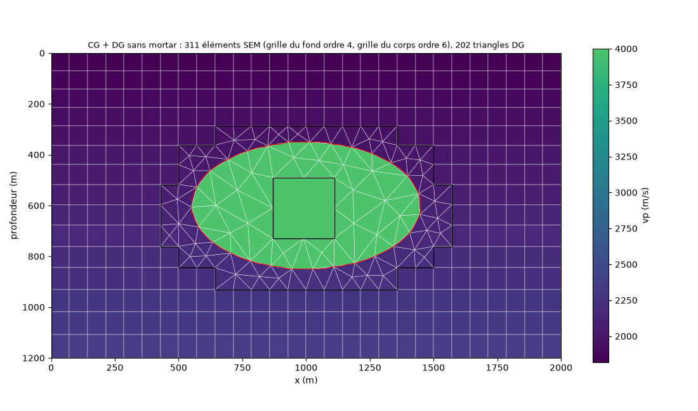

Sur seg2d (tableau ci-dessus), la grille rectiligne réduit le fond de 3 279 à 2 563 éléments (pas
vertical de 60 m en surface à plus de 100 m en profondeur). À ppw fixé, la précision rejoint celle des
autres maillages (2,7 % / 10,3 %). Avec une grille uniforme au pas de la tranche d'eau, on obtenait
7,3 %, mais les sédiments profonds étaient alors sur-échantillonnés (3 795 éléments). Le sel de seg2d est
trop mince (300 à 400 m) pour la maille de 111 à 176 m : il reste presque entièrement en triangles. Sur
Sigsbee (ci-dessous), le sel est assez épais pour être maillé en quadrangles.

Le pas de temps (0,91 ms contre 1,20 ms pour l'hybride mortar) est limité par la bande de triangles. Les
côtés en escalier de la grille du fond imposent de petits triangles. Avec des triangles 1,5 fois plus
grands (`tri_factor` = 2), le pas monte, mais l'écart passe à 6,8 % / 15,8 % : les triangles d'ordre 3
sont alors sous-résolus.

**Sigsbee 2A** (f0 = 4 Hz, 5 ppw, 6 s ; `hybrid_compare_2d.py --model sigsbee2a --f0 4 --tmax 6`), même
référence (hybride mortar 2,5 fois plus fin, 948 429 inconnues). Le sel est assez épais pour que la grille
du corps (pas de 361 m) le couvre en grande partie : les triangles ne restent que dans la bande du contour.

| maillage | taille des triangles | éléments | inconnues | pas stable | traces | instantané |
|---|---|---|---|---|---|---|
| hybride mortar | 4/3 | 10 953 | 169 245 | 1,43 ms | 9,4 % | 8,5 % |
| CG + DG sans mortar | 4/3 | 12 182 | 184 838 | 0,65 ms | 10,0 % | 8,6 % |
| hybride mortar | 1 | 11 967 | 181 890 | 1,41 ms | **6,2 %** | **5,7 %** |
| CG + DG sans mortar | 1 | 12 618 | 189 814 | 0,57 ms | 6,7 % | 5,8 % |
| blocs en escalier | – | 10 586 | 173 661 | 2,42 ms | 8,8 % | 7,7 % |
| grille uniforme | – | 16 960 | 272 529 | 2,66 ms | 7,4 % | 6,7 % |

Avec des triangles P3 de taille $\tfrac43\,p\,v/(f_{\max}\,\text{ppw})$, soit environ 0,8 λ, la bande est
sous-résolue sur ce long trajet : les hybrides font moins bien que les blocs. Avec des triangles 1,33 fois
plus petits (`tri_factor` = 1, 10 % d'éléments en plus), ils deviennent les plus précis. L'erreur
(réflexions du toit et de la base du sel) baisse d'un tiers par rapport aux blocs, avec 30 % d'éléments de
moins que la grille uniforme. Le pas de temps reste pénalisé par les triangles : 1,4 ms contre 2,4 ms
(hybride mortar), 0,6 ms (CG + DG).

**Maillages et temps de calcul** (`apps/mortar/mesh_cost_2d.py`). Prototypes NumPy / SciPy sur un
cœur ; seg2d à 8 Hz, Sigsbee à 4 Hz ; chaque maillage avance à son propre pas, $0{,}8\,\Delta t_{\max}$. Le temps par pas est mesuré
sur 300 pas. Ces temps comparent les approches entre elles. Ils ne prédisent pas ceux d'un noyau GPU, où
les blocs SEM coûtent bien moins que des produits matrice creuse–vecteur.

| modèle | maillage | éléments | constr. | dt stable | temps/pas (ns/inc.) | pas | temps total |
| --- | --- | --- | --- | --- | --- | --- | --- |
| seg2d (3 s) | hybride mortar | 2 745 | 0,3 s | 1,20 ms | 0,90 ms (21) | 3 130 | 3 s |
|  | CG + DG | 3 037 | 0,2 s | 0,91 ms | 0,85 ms (18) | 4 142 | 4 s |
|  | blocs | 2 610 | 0,5 s | 1,42 ms | 0,51 ms (12) | 2 640 | 1 s |
|  | uniforme | 3 698 | 0,1 s | 1,39 ms | 0,51 ms (9) | 2 701 | 1 s |
| Sigsbee (6 s) | hybride mortar | 11 967 | 2,2 s | 1,41 ms | 5,6 ms (31) | 5 303 | 30 s |
|  | CG + DG | 12 618 | 1,4 s | 0,57 ms | 5,7 ms (30) | 13 253 | 76 s |
|  | blocs | 10 586 | 2,6 s | 2,42 ms | 2,2 ms (12) | 3 100 | 7 s |
|  | uniforme | 16 960 | 0,7 s | 2,65 ms | 3,7 ms (13) | 2 826 | 10 s |

Les triangles coûtent deux fois plus par inconnue et par pas (masse pleine par triangle, faces DG), et
ils réduisent le pas de temps. Sur Sigsbee, l'hybride mortar est 4 fois plus lent que les blocs pour un
écart réduit d'un tiers, et le CG + DG 11 fois plus lent. Il reste à le comparer à des blocs plus fins
(ppw plus élevé) qui atteindraient la même précision, avec la même référence. Le coût des triangles est le
point à traiter : pas de temps local sur la bande, et noyau DG dédié.

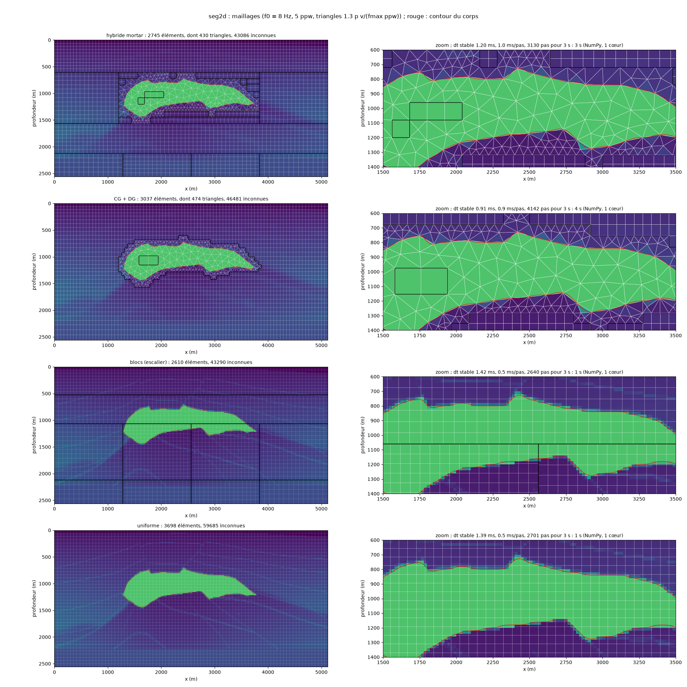
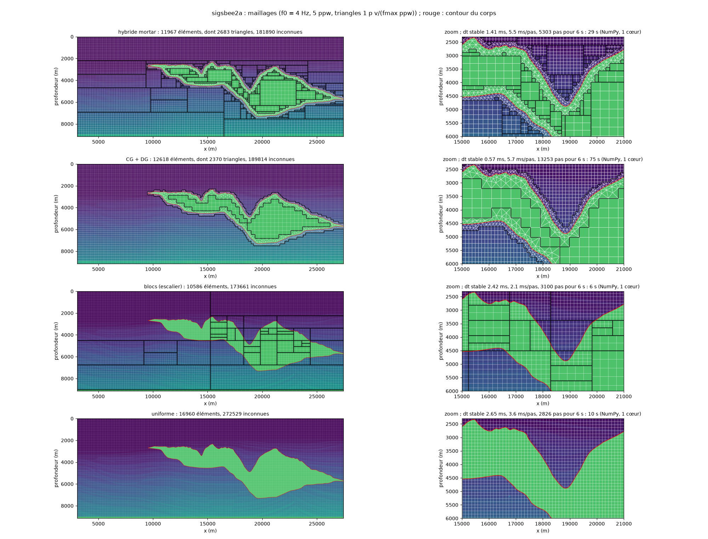

**Sismogrammes et écarts à la référence, à la même échelle de gris** (`hybrid_compare_2d.py`, figure
`sismos_<modèle>.png`) ; puis instantanés et écarts (échelle ×5).

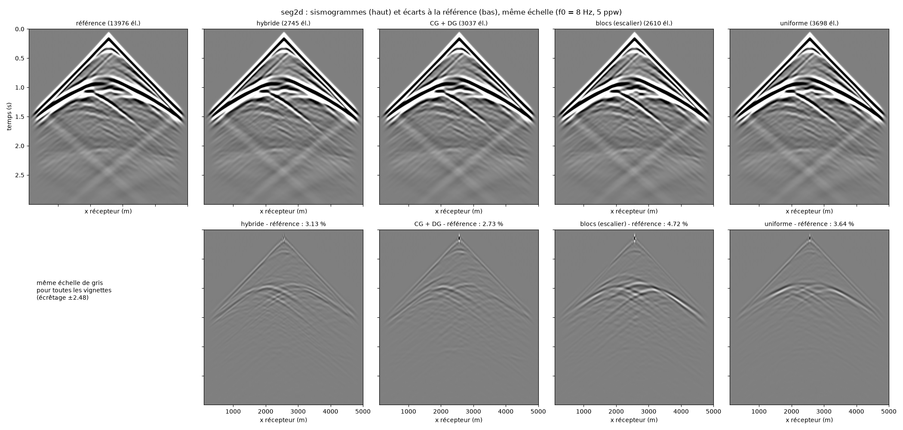
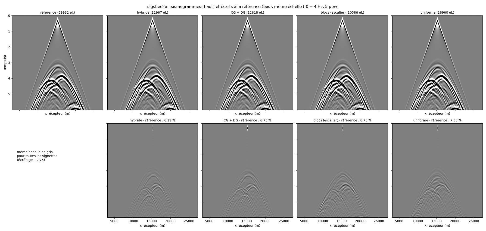
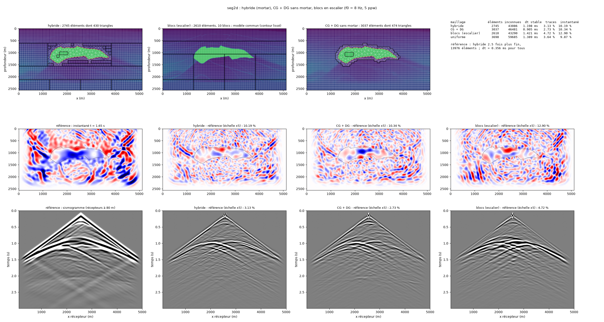
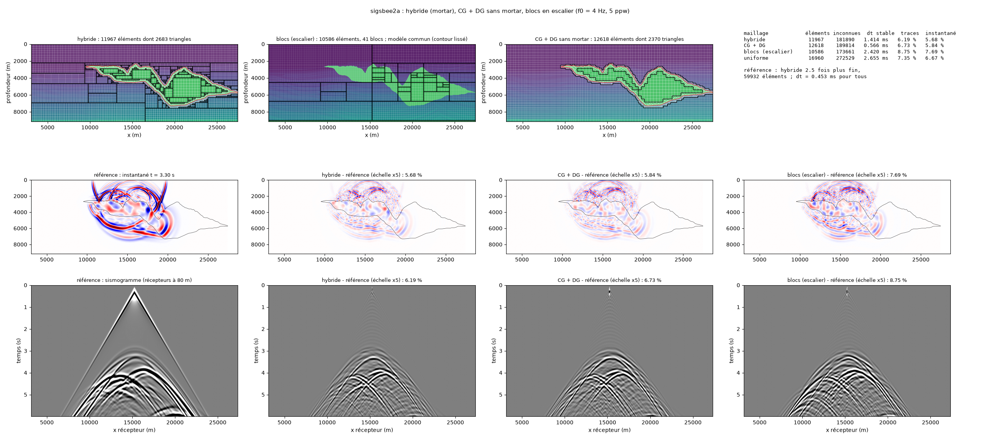

**Reste à faire.**

- Traiter les autres sauts nets (failles, couches) : bandes de triangles sur toutes les interfaces
  nettes, ou blocs coupés sur celles qui sont alignées.
- Bande de triangles plus mince à l'intérieur des corps ; pas de temps des triangles (CG + DG : ordre 4
  dans la bande, ou division des côtés en escalier par 2 pour des triangles moins aplatis).
- Coût des triangles : pas de temps local sur la bande, ordre 4 ; `tri_factor` = 1 par défaut.
- Bords absorbants et surface libre sur les triangles.
- Portage FUnTiDES de la variante CG + DG (triangle DG, couplage quadrangles–triangles, composite
  `semdg2d`) : plan par lots et efforts dans `FUnTiDES-dir/point-2026-11-12.md`.

## 10. Références

- J. S. Hesthaven, T. Warburton, Nodal Discontinuous Galerkin Methods, Springer (2008).
- D. N. Arnold, An interior penalty finite element method with discontinuous elements, SIAM J. Numer.
  Anal. 19 (1982).
- M. J. Grote, A. Schneebeli, D. Schötzau, Discontinuous Galerkin finite element method for the wave
  equation, SIAM J. Numer. Anal. 44 (2006).
- P. F. Antonietti, I. Mazzieri, A. Quarteroni, F. Rapetti, Non-conforming high order approximations of
  the elastodynamics equation, CMAME 209-212 (2012).
- J. Diaz, M. J. Grote, Energy conserving explicit local time stepping for second-order wave equations,
  SIAM J. Sci. Comput. 31 (2009).
- M. J. Grote, S. Michel, S. A. Sauter, Stabilized leapfrog based local time-stepping method for the
  wave equation, Math. Comp. 90 (2021).
