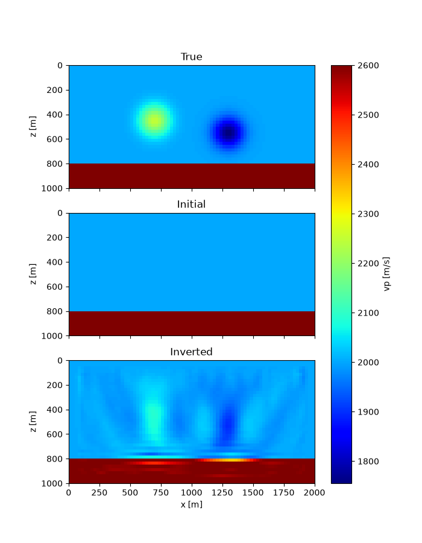
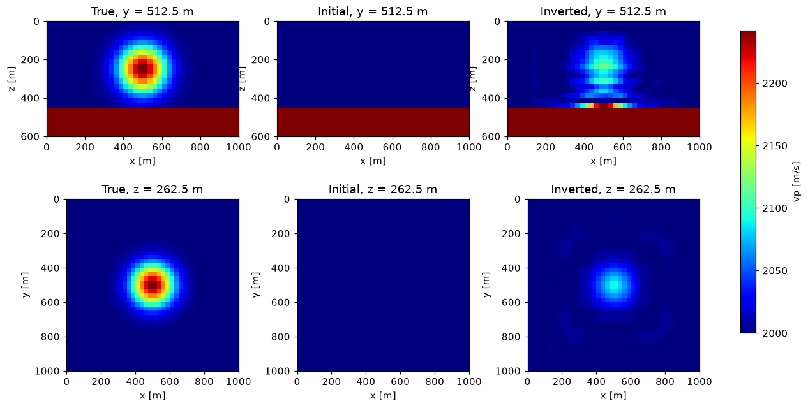
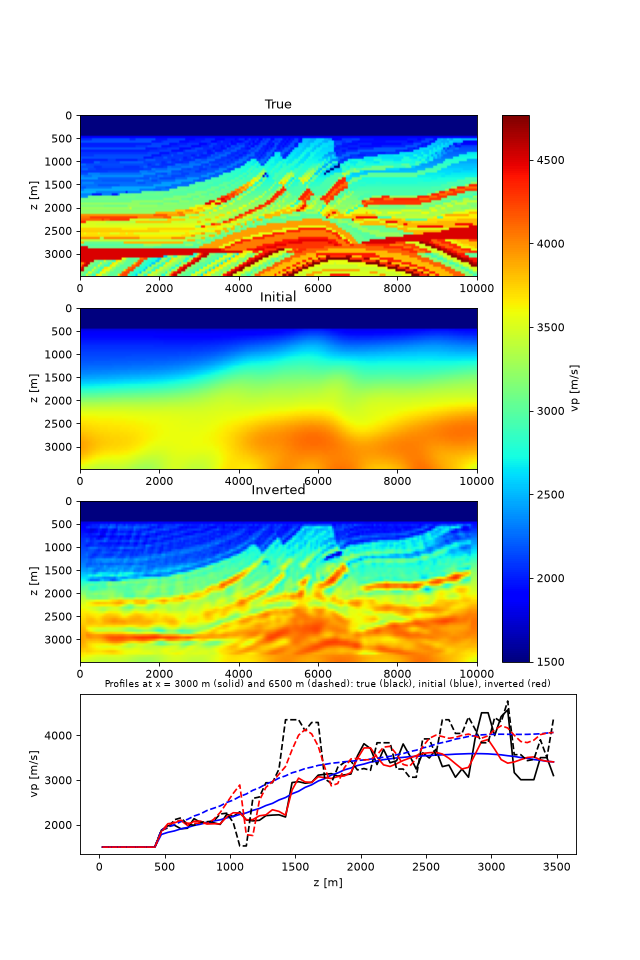

Full-waveform inversion
#######################

:file:`apps/fullWaveformInversion/fwi.py` inverts acoustic velocities from observed SEG-Y
data (method: :doc:`../userguide/fwi`).

Running
=======

.. code-block:: bash

    source <FUnTiDES install>/funtides_env.sh
    python <FUnTiDES-App>/python/apps/fullWaveformInversion/fwi.py --param_file fwi_parameters.txt
    mpirun -np 4 python .../fwi.py --param_file fwi_parameters.txt        # shots dealt out to 4 ranks
    python .../fwi.py --param_file fwi_parameters.txt --restart --rfile velocityModel3.hdf5

Inputs:

- the initial model, SEP (:code:`vpFile`): it sets the domain, the mesh and the time step;
- the observed data, one SEG-Y file per shot in :code:`dataDirectory`, named
  :code:`<rootname><shot id><extension>` (:code:`dinfo`); the acquisition is read from their
  headers, or from a decision file (:code:`decision`);
- the parameter file, one :code:`key=value` per line:

.. literalinclude:: ../../../apps/fullWaveformInversion/fwi_parameters_example.txt
    :language: bash

Outputs: :file:`velocityModel<n>.hdf5` (model after n updates, dataset :code:`velocity`,
flat per element in the parametrisation :code:`model`), :file:`finalModel.hdf5`,
:file:`fullCostFunction.txt` (iteration, J; the iteration index restarts at 0 at each
frequency). :code:`--dbg` keeps the gradients and illuminations
(:file:`partialGradient/fullGradient<n>.hdf5`) and the cost of every shot and evaluation;
:code:`--dbg+` also exports the simulated traces and the residuals.

Two anomalies (anomaly_2d)
==========================

:file:`apps/fullWaveformInversion/examples/anomaly_2d`: 2 x 1 km, background 2000 m/s,
Gaussian anomalies of +250 and -250 m/s above a reflector at 800 m (known), 8 shots and 73
receivers at the surface, Ricker 10 Hz; observed data on the same mesh. :file:`make_case.py`
writes the models, the data and the parameters, :file:`check_result.py` compares with the
true model.

.. code-block:: bash

    python examples/anomaly_2d/make_case.py --outdir run --method CGPR --maxiter 15 \
        --extra "minDepth=50;gradEdge=50;gradTaper=50;illumination=true"
    (cd run && python ../fwi.py --param_file fwi_parameters.txt)
    python examples/anomaly_2d/check_result.py --rundir run --png result.png

    CGPR, 15 iterations without filter (40 s on an RTX 40xx GPU): J / J0 = 0.012; the anomalies are
    found at the right place, smeared vertically (+92 and -104 m/s). With
    :code:`freqFilterList=5,8,12`: +162 and -155 m/s.

One anomaly in 3-D (anomaly_3d)
===============================

:file:`apps/fullWaveformInversion/examples/anomaly_3d`: 1 x 1 x 0.6 km, background
2000 m/s, Gaussian anomaly of +250 m/s at 250 m depth above a reflector at 450 m (known),
9 shots on a 3 x 3 grid and 81 receivers on a 9 x 9 grid at 25 m depth, Ricker 8 Hz,
25 m elements of order 2 (321 000 nodes); observed data on the same mesh.

.. code-block:: bash

    python examples/anomaly_3d/make_case.py --outdir run3d          # models and data (10 s)
    (cd run3d && python ../fwi.py --param_file fwi_parameters.txt)
    python examples/anomaly_3d/check_result.py --rundir run3d --png result.png

    CGPR, 8 iterations (2 min 47 s on an RTX 40xx GPU, 70 MiB of snapshots per shot):
    J / J0 = 0.054; +114 m/s at the centre of the anomaly, found within 13 m, model error
    above the reflector 0.59. As in 2-D, part of the update goes into the reflector.

Marmousi 2-D
============

:file:`apps/fullWaveformInversion/examples/marmousi_2d`: true model Marmousi, initial model
smoothed by a 300 m Gaussian below the water (1500 m/s, 440 m, not updated), 16 shots, 499
receivers every 20 m, 3 s, Ricker 8 Hz, order 4, 50 m elements; frequencies 4, 6 and 9 Hz,
10 CGPR iterations each, :code:`gradEdge=100`, illumination.

.. code-block:: bash

    python examples/marmousi_2d/make_case.py --outdir marmousi_run          # models and data (10 s)
    (cd marmousi_run && python ../fwi.py --param_file fwi_parameters.txt)
    python examples/marmousi_2d/check_result.py --rundir marmousi_run --png result.png

.. figure:: marmousi_2d.png
    :scale: 70
    :align: center

    21 min on an RTX 40xx GPU (30 iterations, about 40 gradients of 16 shots); J / J0 per stage
    0.11, 0.56, 0.49. The faults, the low-velocity wedge and the layers of the upper 2 km are
    recovered; the deep part stays close to the initial model.

Without inverse crime
---------------------

With :code:`--data-elem 25` the observed data are computed on 25 m elements (time step
halved), the inversion keeping its 50 m elements: the two meshes give seismograms 20 to 40 %
apart (discretisation of the model and of the wavefield), which the inversion cannot fit.

.. code-block:: bash

    python examples/marmousi_2d/make_case.py --outdir marmousi_nocrime --data-elem 25   # 30 s

    13 min (the 6 and 9 Hz stages stop after 7 and 8 iterations, Wolfe line search); J / J0
    per stage 0.33, 0.84, 0.74 (the modelling error stays in the residual); model error
    below the water 0.80 of the initial one (0.79 with the inverse crime). The same
    structures of the upper 2 km are recovered.

anomaly_2d computes the observed data on the mesh of the inversion (inverse crime).
