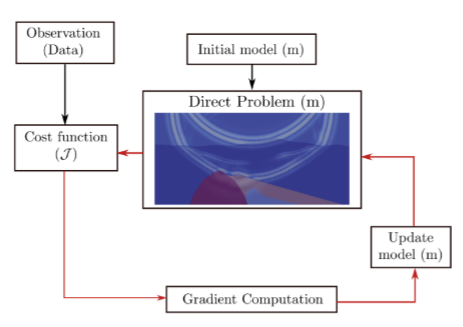

Full waveform inversion
#########################

Full Waveform Inversion (FWI) is a seismic imaging technique that retrieves high resolution models.

The basic scheme is as follow:

.. role:: raw-html(raw)
    :format: html

Starting fom an initial guess for the model :raw-html:`<strong>m0</strong>`, the data model **m** is predicted through wave equation calculation. The model **m** is then compared to the real subsurface data observations and the cost function **J** is computed to evaluate the misfit. The model is updated and this iterative process goes on until the misfit is small enough to give a final model.

An example of Full Waveform Inversion for the acoustic case is given in the :file:`workflows/fullWaveformInversion` folder.

1. Required files
===================
 - parameters file
 - VTK file containing starting model as :code:`CellData` field format
 - xml file
 - observation data as segy files

1.1 Parameters file
+++++++++++++++++++++
A lot of running parameters are extracted from a parameter file created by the user: observation data directory, velocity constraints on the model for example.

.. code-block:: bash

    dtWaveField=0.002
    dataDirectory=FORWARD/seismicData_6Hz
    dinfo=seismoTrace_shot;5;.sgy
    freqFilterList=3,5,7,9,12,15
    minDepth=450
    method=steepestDescent
    model=1/c2
    minimizerOptions={"minModel":1500, "maxModel":5300, "minls":3, "maxls":3, "nbCFcheck":3, "maxiter":10}

- Here, the observation data is stored in :code:`dataDirectory`, the format of the data filename is given *via* :code:`dinfo` (<rootname>;<shot id formatting>;<extension>). 

- The minimizer options should be given in the form of python dictionnary formatting as shown above. 

Feel free to check the other options in the main script :code:`parse_workflow_parameters` function.

1.2 Starting velocity model file
++++++++++++++++++++++++++++++++++++
The starting model should be given as :code:`CellData` of a VTK file. The array name in the VTK file should be specified in the command line with the flag :code:`--mname` while the VTK filename should be given in the xml file.

1.3 XML file
++++++++++++++
The input xml file is designed similarly to other modeling runs. For example, if you run this example FWI with artifical data (run an acoustic modeling case beforehand for example), then you can re-use the same xml, with only the VTK file for the starting model that is modified.

1.4 Observation data
+++++++++++++++++++++++
The observation data should be given as segy traces containing all the sources and receivers positions. The acquisition is set *via* the :code:`SEGYAcquisition` class that lists all the segy data contained in a given folder (see `Acquisition <../../userguide/input/acquisition/acquisition.html>`_ section of the user guide)

2. Running the FWI code
=========================

The FWI example workflow is currently designed for client-server jobs, with the use of :program:`RPC` library.

You can find below the structure of a command line launching a FWI run, with a client-server configuration.

::

    cd workflows/fullWaveformInversion
    Launcher --np=12 --ppn=6 --server_queue=Q_SER --queue=Q_CLI --nb_clients=2 --gpn=6 --flag_cliser python3 fwi.py --xml xmlfile.xml flag_cli_ser=1 --param_file parameter_file.txt --mname velocityVp

3. Outputs
============
By default, only the full gradient, velocity models and full cost function are saved.

You can change the running options to save also the residual and the seismic traces with the respective keynames: :code:`exportResidual` and :code:`exportSeismicTraces`.

The intermediate cost functions, as well as partial cost functions and gradients can also be kept by setting the run in debug mode. This is done by adding the flag :code:`--dbg` in the command line.

Note that you can also use the full debug mode if you wish to save all IO and all residual and seismic traces. Use the flag :code:`--dbg+` in the command line.

The visualization scripts are available in the :file:`workflows/display` folder. You will find below examples of command lines for the outputs.

3.1 Velocity model
++++++++++++++++++++
The FWI workflow saves a velocity model per FWI iteration with the filename :file:`velocityModel{N}.hdf5`. 
You can visualize a slice with the script :file:`showVelocityModel.py`. 

Example of command line:

.. code-block:: bash

    python3 showVelocityModel.py velocityModel3.hdf5 velocityModel4.hdf5 --vmodel=1/c2 --n 45 30 25 --index 15 --nf 100

Please use the run option :code:`--help` to check all the flags and parameters.

3.2 Gradient
+++++++++++++++
The full gradient is saved in HDF5 format with the filename :file:`fullGradient.hdf5`. The gradient is written over at each iteration. Only in debug mode, a new file is created for each iteration.

The visualization of the full gradient can be done with the script :file:`showFullGradient.py`.

Example of command line:

.. code-block:: bash

    python3 showFullGradient.py fullGradient.hdf5 --n 45 30 25 --index 15 --nf 100

.. Note:: You can also use this script to visualize the partial gradients files by adding the flag :code:`--fname=partialGradient` in the command line.

3.3 Seismic traces
+++++++++++++++++++
The pressure at receivers is saved as SEGY format  with the filename :file:`seismoTrace_shot{ID}_{sourceFrequency}.segy`. By default, they are saved in the folder :code:`seismicTraces`, an option that you can change in the txt parameters file with the flag :code:`traceDirectory`.

Example of command line:

.. code-block:: bash

    python3 showSeismicTrace.py --dir=seismicTraces seismoTrace_shot00001.segy 

3.4 Residual
++++++++++++++
The computed residuals are saved in the :file:`residual` folder with the filename :file:`seismoTrace_shot{ID}_{sourceFrequency}.segy`. 
You can also use the script :file:`workflows/display/showSeismicTraces.py` to visualize the residuals, with a similar command line as in the previous section.

3.5 Cost function
+++++++++++++++++++
The cost functions are saved as txt files. If you run in non-debug mode, only the minimized cost function is saved (one for each FWI iteration). The full cost function is saved in the file :file:`fullCostFunction.txt` with the following format:

:: 

    #Example of fullCostFunction.txt
    #FWI iteration #fullCostFunction
    0        0.05469396139740052
    1        0.011357651492783125
    2        0.011084207214983632
    3        0.008389842620442473
    0        0.26499969381870303
    1        0.11318670033630764
    2        0.13678087807539904
    3        0.10332539556124892
    4        0.08262941838038589
    5        0.056445463786637125
    6        0.044792344257110706

In debug mode, all the intermediate cost function are saved in files containing the filtering frequency *F* value in their name such as :file:`fullCostFunction{F}.txt`.