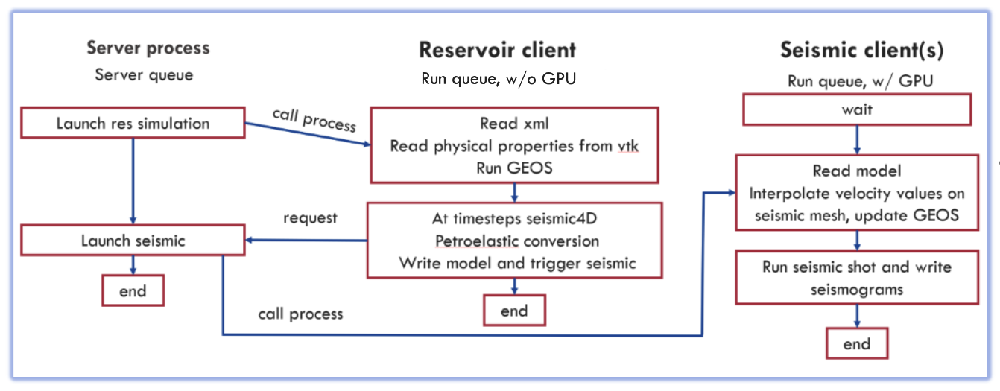

Reservoir and reservoir-seismic coupling
###########################################

1. Reservoir workflow
======================

An example of reservoir workflow is present in the folder :file:`apps/reservoir/reservoir.py`.

The input files are located in the :file:`example` subfolder. You will find the xml input file :file:`reservoir.xml`, and three parametric files used to define the initial conditions: :file:`co2flash.txt`, :file:`pvtgas.txt`, :file:`pvtliquidezrokhi.txt`.

Steps
---------

1.1 Initialization
+++++++++++++++++++
The initialization starts with the definition of the solver using the class :code:`ReservoirSolver`. 

Then you need to add the two necessary steps:

.. literalinclude:: ../../../../apps/reservoir/reservoir.py
    :language: python
    :lines: 16-25
    :linenos:
    :lineno-start: 16

It is not necessary to define explicitely the :code:`xml` variable if you have used the flag :code:`--xml` in the command line.

1.2 Time loop
+++++++++++++++
As the :code:`ReservoirSolver` is a non-linear solver, the time step is updated at each step. In the code, this time step corresponds to the attribute :code:`initialDt`. 

You can see this update in the following time loop:

.. literalinclude:: ../../../../apps/reservoir/reservoir.py
    :language: python
    :lines: 27-37
    :linenos:
    :lineno-start: 27

1.3 Gathering fields
++++++++++++++++++++++

Once the time loop has finished, we can extract interesting information from the fields. In our example, we will retrieve the pressure, deltaPressure, phase volume fraction of gas, phase volume fraction of water and the rock porosity.

2. Coupled reservoir and seismic workflow
===========================================
For now, you have seen both a C0\ :sub:`2` injection workflow and a seismic modeling workflow independantly. The next interesting part is to couple both in order to check the seismic modifications induced by the injection.

In our example, the client-server mode is required, with the use of :program:`RPC` library.

The global scheme of the workflow is found below:

2.1 Reservoir simulation
---------------------------
The server process triggers the launch of the reservoir simulation.

To follow the seismic modifications induced by the C02 injection, we want to get the seismic model at specific time steps **dtSeismic4D**.

This is done by adding artificially an event in the XML :code:`Event` section.

.. code-block:: xml

    <PeriodicEvent
      name="seismic4D"
      timeFrequency="3.45024e8"
      targetExactTimestep="1" />

.. role:: raw-html(raw)
    :format: html

The petroelastic model (PEM) defined by the user in the local :file:`PEM.py` file, is used to generate the corresponding velocity model at this time step :raw-html:`<strong>tn</strong>`

The reservoir client then requests the server to launch the seismic simulation for the model :raw-html:`<strong>mn</strong>`.

The reservoir simulation ends as usual one the full time loop has been executed.

2.2 Seismic simulation
-------------------------
Once the model at time :raw-html:`<strong>tn</strong>` is created, the reservoir client requests the launch of seismic client for the model :raw-html:`<strong>mn</strong>`.

The seismic client reads the seismic model :raw-html:`<strong>mn</strong>` generated by the reservoir simulation and interpolate the velocity values on the seismic mesh.

The mesh is then updated on :program:`GEOS` side and a regular seismic modeling simulation runs.