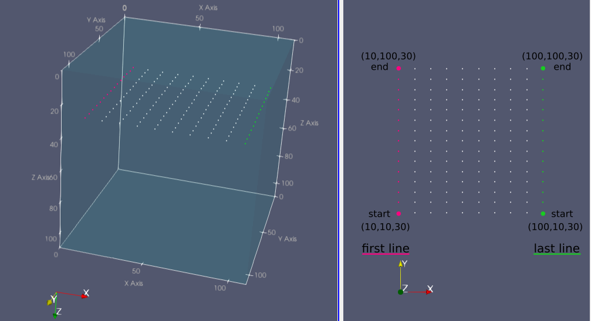
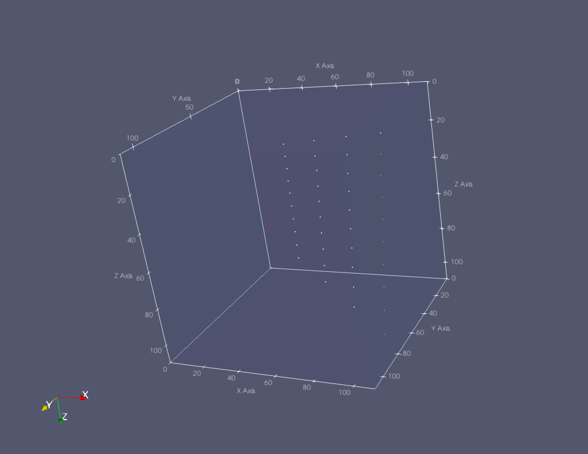

Acquisition
###########

An acquisition is a list of shots (:code:`acquisition.shots`); a shot is one source and
its receivers (:meth:`Shot.getSourceCoords`, :meth:`Shot.getReceiverCoords`), with an id
(:code:`shot.id`, 5 digits) used in the file names. All the classes are in
:mod:`makutu.acquisition`; coordinates follow the :doc:`conventions`.

From coordinates
================

The same receivers for every source:

.. code-block:: python

    import numpy as np
    from makutu.acquisition import Acquisition

    sources = [[x, 0.0, 10.0] for x in np.linspace(300.0, 9700.0, 16)]
    receivers = [[x, 0.0, 20.0] for x in np.arange(20.0, 10000.0, 20.0)]
    acquisition = Acquisition(sources=sources, receivers=receivers)

The coordinates may also be numpy arrays (:code:`np.loadtxt("sources.txt")`).
:meth:`Acquisition.splitAcquisition` divides the shots into several acquisitions.

From SEG-Y files
================

:class:`SEGYAcquisition` reads the positions in the trace headers of all the SEG-Y files of
a directory (one file per shot, sorted by name; the shot ids follow that order):

.. code-block:: python

    from makutu.acquisition import SEGYAcquisition

    acquisition = SEGYAcquisition(segdir="obs", ignore=["bad_shot.sgy"])

The header words read are :code:`sx`, :code:`sy`, :code:`sdepth` for the source and
:code:`gx`, :code:`gy`, :code:`gelev` for the receivers (options :code:`sbit`,
:code:`rbit`), with the scalars :code:`scalco` and :code:`scalel`, as written by
:class:`makutu.output.SEGYTraceOutput.SEGYTraceOutput`.

From decision files
===================

:class:`DecisionAcquisition` reads a decision file (one line per trace, the words of the
source and receiver positions) and its database; :func:`create_decision_files` writes
decision files, for instance from SEG-Y files:

.. code-block:: bash

    python3 makutu/acquisition/decision_create.py --from-segy shot_1.sgy shot_2.sgy \
        --out acquisition/decision --index-words 22,23,14

.. code-block:: python

    from makutu.acquisition import DecisionAcquisition

    acquisition = DecisionAcquisition(decision_filename="acquisition/decision", scalco=1, scalel=1)

:file:`makutu/acquisition/check_acquisition.py` compares an acquisition with SEG-Y files
and plots it; :file:`makutu/acquisition/create_equispaced_segy.py` writes the SEG-Y headers
of a regular acquisition. Both print their options with :code:`--help`.

Regular grids
=============

:class:`EQUISPACEDAcquisition` builds lines of sources and of receivers between the ends
of the first and of the last line (the receivers are the same for every shot):

.. code-block:: python

    from makutu.acquisition import EQUISPACEDAcquisition

    acquisition = EQUISPACEDAcquisition(startFirstSourceLine=[10, 10, 10], endFirstSourceLine=[10, 100, 10],
                                        startLastSourceLine=[100, 10, 10], endLastSourceLine=[100, 100, 10],
                                        numberOfSourceLines=10, sourcesPerLine=10,
                                        startFirstReceiversLine=[10, 10, 30], endFirstReceiversLine=[10, 100, 30],
                                        startLastReceiversLine=[100, 10, 30], endLastReceiversLine=[100, 100, 30],
                                        numberOfReceiverLines=10, receiversPerLine=15)
    len(acquisition.shots)      # 100

    Receivers of the example above.

The lines may have any direction:

Not available: limited-aperture acquisitions (:meth:`Acquisition.limitedAperture` raises
:code:`NotImplementedError`).
