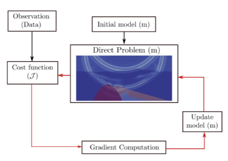

Full-waveform inversion
#######################

The FWI minimises the least-squares misfit between observed and simulated seismograms,
J(m) = sum over the shots of dt / 2 * sum(residual\ :sup:`2`), from an initial model m0.
The application is :file:`apps/fullWaveformInversion/fwi.py` (:doc:`../example/fwi`); its
building blocks are below.

Cost and gradient
=================

- :func:`makutu.forwardBackward.func` (x, data directory, ...) returns J;
- :func:`makutu.imaging.gradf` (x, ..., :code:`computeFullCF=True`) returns the gradient and
  J (one forward run with snapshots and one adjoint run per shot), and the summed
  illumination in :code:`makutu.imaging.globals.illumination`.

Both read the observed data (one SEG-Y file per shot, named by :code:`dinfo`), filter the
source and the data at the current frequency, and apply the model x in memory. They use the
solver and the acquisitions given to :func:`makutu.imaging.initializeGlobalVariables`.

Verified (integrated tests): gradient against finite differences (2-D orders 1 to 3, 3-D,
the three parametrisations), Taylor test (second-order remainder), source-receiver
reciprocity, MPI.

Multi-scale
===========

:code:`freqFilterList` gives the filter frequencies of successive stages, each starting
from the model of the previous one. The source and the data are low-pass filtered by the
same causal Butterworth filter (:func:`makutu.tools.frequencyFilter`, -3 dB at the
frequency): filtering the source before the simulation then gives the filtered data (0.1 %).

Optimisers
==========

:class:`makutu.imaging.Minimizer` (method name):

- :code:`steepestDescent`, :code:`CGPR2`: heuristic line search (trial steps, the best
  kept if it lowers J);
- :code:`SD2`, :code:`CGPR` (Polak-Ribière+): Wolfe line search
  (:func:`scipy.optimize.line_search`), the first step scaled on the last decrease of J; J
  is computed with the gradient and the gradient of the accepted step is reused (about one
  gradient per iteration);
- any :func:`scipy.optimize.minimize` method (e.g. :code:`L-BFGS-B`).

The model is kept within the bounds; the iterations stop on the relative decrease of J
(:code:`Jtol`), on a stagnation of J, or after :code:`maxiter`.

Conditioning
============

:class:`makutu.imaging.GradientConditioner` builds the descent direction (the line searches
keep the true gradient): no update above :code:`minDepth` (water, sources and receivers)
and within :code:`edge` of the sides and the bottom (absorbing terms not differentiated),
cosine ramps of :code:`taper`, and optionally division by the illumination
(pseudo-Hessian, stabilised by :code:`eps` times its maximum).
