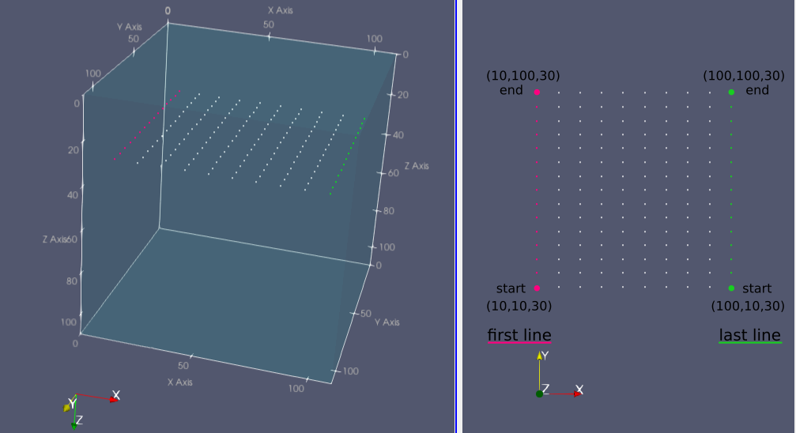
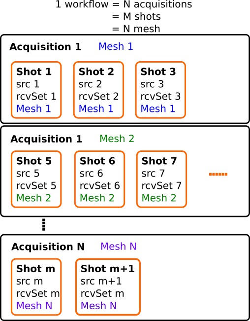

Acquisition
#############

In order to run a seismic modeling, it is necessary to define your acquisition, *i.e* the positions of the receivers and sources. This guide will show you the different options available and how to use them.

.. warning:: For all these options, a given shot configuration corresponds to one source.

.. warning:: For now the receiver set provided is the same for all the shots, if you wish to change the set for each shot, you will need to define several `Acquisition` objects for one run (thus one `Acquisition` for one receiver set).

1. Define explicitly in the xml
=================================
The first option is to write explicitly the coordinates of the sources and receivers in the xml input file. They should be defined in the :code:`Solvers` field, for the keywords :code:`sourceCoordinates` and :code:`receiverCoordinates`, as in the following example.

.. code-block:: xml

    <Solvers>
        <AcousticSEM
            name="acousticSolver"
            cflFactor="0.25"
            discretization="FE1"
            targetRegions="{ Region1, Region2 }"
            sourceCoordinates="{{700.0, 1000, 520},
                                {850.0, 1000, 520},
                                {1000.0, 1000, 520}}"
            timeSourceFrequency="2.0"
            receiverCoordinates="{{100.0, 1000, 520},
                                 {300.0, 1000, 520},
                                 {500.0, 1000, 520},
                                 {700.0, 1000, 520}}"
            outputSeismoTrace="0"
            dtSeismoTrace="0.1"/>
    </Solvers>

Now we need to define the acquisition in the :program:`Python` main script, with the use of :code:`Acquisition` class. 

.. code-block:: python

    from makutu.input import XML
    from makutu.acquisition import Acquisition

    xml = XML("problem.xml")
    acquisition = Acquisition(xml=xml)

Only the :code:`xml` parameter is required in this case, the program will extract the sources and receiver coordinates from the xml directly.

    >>> for shot in acquisition.shots:
    ...     print(f"Shot {shot.id}", shot.getSourceCoords(), shot.getReceiverCoords())
    Shot 00001 [[700.0, 1000.0, 520.0]] [[100.0, 1000.0, 520.0], [300.0, 1000.0, 520.0], [500.0, 1000.0, 520.0], [700.0, 1000.0, 520.0]]
    Shot 00002 [[850.0, 1000.0, 520.0]] [[100.0, 1000.0, 520.0], [300.0, 1000.0, 520.0], [500.0, 1000.0, 520.0], [700.0, 1000.0, 520.0]]
    Shot 00003 [[1000.0, 1000.0, 520.0]] [[100.0, 1000.0, 520.0], [300.0, 1000.0, 520.0], [500.0, 1000.0, 520.0], [700.0, 1000.0, 520.0]]

For more information about the :code:`xml` input file, please check the `XML <../xml.html>`_ section of this documentation, or `GEOS documentation <https://geosx-geosx.readthedocs-hosted.com/en/latest/coreComponents/fileIO/doc/InputXMLFiles.html#>`_ for a more generic help.

2. Reading from an array or a list
===================================
Writing all the coordinates in the xml files will be rapidly annoying once the problem gets bigger. The next solution is to use numpy arrays to define the acquisition. In the main script, you can define as follows the sources and receivers coordinates.

.. code-block:: python

    # python main script
    import numpy as np
    from makutu.acquisition import Acquisition

    sources = [[xs, 1000.1, 520.1] for xs in np.linspace(700.1, 1300.1, 5)]
    receivers = [[xr, 1000.1, 520.1] for xr in np.linspace(100.0, 1900.1, 80)]
    acquisition = Acquisition(sources=sources, receivers=receivers)

The :code:`Acquisition` class also accept numpy arrays, so you can either define them manually, or extract the sources and receivers coordinates from a .txt file and define the acquisition like below for example.

:: 

    #sources.txt
    325.0 200.1 320.0
    525.1 520.0 450.0

:: 

    # receivers.txt
    200.1 250.1 350.1
    250.1 300.1 350.1
    300.1 300.1 350.1
    350.1 300.1 350.1
    400.1 300.1 350.1
    450.1 300.1 350.1

.. code-block:: python

    # python main script
    import numpy as np

    sources = np.loadtxt("sources.txt")
    receivers = np.loadtxt("receiver.txt")

    acquisition = Acquisition(xml, sources=sources, receivers=receivers)

3. Reading from segy or decision files
=======================================
A more robust way to define the acquisition is to use :code:`segy` or :code:`decision` files.

3.1 Segy files
----------------
    
The :code:`SEGYAcquisition` class is able to read and extract acquisition configurations from `segy` files.
In that case, you will need to provide the directory containing the `segy` files.

.. warning:: All segy files in the given directory are read.

.. code-block:: python

    from makutu.acquisition import SEGYAcquisition

    segdirectory = "./seismicTraces/"

    acquisition = SEGYAcquisition(xml,
                                  segdir=segdirectory)

.. Important:: By default all segy files in the directory are read. Please use the keyword option :code:`ignore` to prevent specific file (or list of files) to be read.
    
    .. code-block:: python
        
        acquisition = SEGYAcquisition(xml,
                                  segdir=segdirectory,
                                  ignore="ignore1.segy")

    .. code-block:: python
        
        acquisition = SEGYAcquisition(xml,
                                  segdir=segdirectory,
                                  ignore=["ignore1.segy", "ignore2.segy"])

    

3.2 Decision files
---------------------

It is also possible to use a decision file reader provided by the :program:`pySABL` module.

.. code-block:: python

    from makutu.acquisition import DecisionAcquisition

    acquisition = DecisionAcquisition(decision_filename="../decision", database="../database")

Several keyword arguments are available for the extraction and definition of the shot configuration. (:code:`help(DecisionAcquisition.decisionReader)` in a python console can show you all the keyword accepted)

.. Note:: The :code:`decisionReader` from :code:`DecisionAcquisition` class is a static function that can therefore be used outside

    .. code-block:: python

        from makutu.acquisition import DecisionAcquisition

        src, rcv, n = DecisionAcquisition.decisionReader(decisionFile, databaseFile)

4. Define a toy-acquisition
============================
This option allows you to define easily a grid for the receivers and the sources independently.

.. IMPORTANT:: The set of receivers will be the same for all the shots.

This features the :code:`EQUISPACEDAcquisition` class from the :code:`makutu.acquisition` package. This class allows you to define a grid of sources and receivers.

You will need to provide:
    - the **number of lines**
    - the number of sources/receivers **per line**
    - start and end coordinates of the **first** line
    - start and end coordinates of the **last** line

.. code-block:: python3

    from makutu.acquisition import EQUISPACEDAcquisition

    acquisition = EQUISPACEDAcquisition(xml=xml,
                                        startFirstSourceLine=[10,10,10],
                                        endFirstSourceLine=[10,100,10],
                                        startLastSourceLine=[100,10,10],
                                        endLastSourceLine=[100,100,10],
                                        numberOfSourceLines=10,
                                        sourcesPerLine=10,
                                        startFirstReceiversLine=[10,10,30],
                                        endFirstReceiversLine=[10,100,30],
                                        startLastReceiversLine=[100,10,30],
                                        endLastReceiversLine=[100,100,30],
                                        numberOfReceiverLines=10,
                                        receiversPerLine=15)

::

    >>> len(acquisition.shots)
    100

The figure below show you the positions of the set of receivers generated by the example above.

.. Note:: There is no restriction on the direction of the lines. 

    .. code-block:: python3

        from makutu.acquisition import EQUISPACEDAcquisition

        acquisition = EQUISPACEDAcquisition(xml=xml,
                                            startFirstSourceLine=[10,10,10],
                                            endFirstSourceLine=[10,100,10],
                                            startLastSourceLine=[100,10,10],
                                            endLastSourceLine=[100,100,10],
                                            numberOfSourceLines=10,
                                            sourcesPerLine=10,
                                            startFirstReceiversLine=[10,10,30],
                                            endFirstReceiversLine=[30,40,70],
                                            startLastReceiversLine=[90,20,20],
                                            endLastReceiversLine=[105,80,100],
                                            numberOfReceiverLines=5,
                                            receiversPerLine=10)

    .. figure:: equispaced_acq2.png
        :scale: 60

5. Limited aperture
=====================

Limited aperture acquisitions can be defined for VTK meshes for all types of acquisitions.

.. rubric:: Definition of the submesh

In order to define correctly a limited aperture acquisition, it is important to define properly the :code:`Acquisition` object first. One acquisition = one submesh.

    
    Representation of limited aperture configuration that should be set

For a given :code:`Acquisition`, the center of the submesh is defined as the central position of all its shots sources *C*. The original mesh is cropped thanks to distance parameters given by the user. 

.. IMPORTANT:: This distance for each axis correspond to the distance to *C* the center of the submesh. With *d* this distance, the total length of the submesh for this direction will be *L = dx2* at most.

If *C* is located within a distance *l<d* from the boundary then the total length of the submesh in this axis will be adapted to *L = l+d* (given the fact that it is further from the boundary in the opposite direction).

.. rubric:: Example of workflow

The script :code:`apps/examples/acquisition_limitedAperture.py` shows an example of client-server workflow in which the re-definition of submeshes is integrated directly in the main script. 

.. code-block:: bash

    Launcher --np=12 --ppn=6 --server_queue=Q_SER --queue=Q_CLI --nb_clients=3 --gpn=4 --flag_cliser python3 acquisition_limitedAperture.py -i xmlfiles/bicoucheAcousticVTK.xml -z 12 flag_cli_ser=1 --LA --l1=200 --l2=300 --l3=500

First, we define two acquisitions of *3* and *5* sources each. For a given acquisition, we define a line of *300* receivers which will be the same for all its shots.

The distances parameters *l1*, *l2*, *l3* for the submesh cropping are parsed from the command line.

Then we run a forward problem in limited aperture configuration (flag :code:`LA` in the command line).

A loop on the acquisitions is dispatched between the clients. 
    1. First, the submesh should be defined and the corresponding VTK file as well as the updated xml input file.

    2. Then after this step is done, all the shots are dispatched for a "conventional" time loop, with the exception of a condition  specific to the client-server configuration.

    3. Considering that the client executing the Shot 1 of Acquisition 2 has only treated the Acquisition 1 previously (or none at all), the configuration of limited aperture has to be done, without the creation of the xml and VTK files. 

.. literalinclude:: ../../../../../apps/modeling/examples/acquisition_limitedAperture.py
    :language: python
    :lines: 63-65