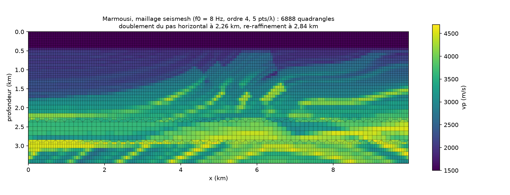
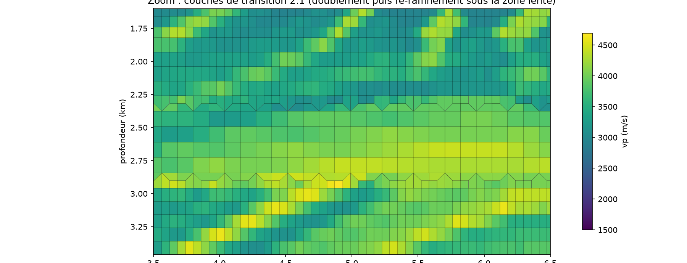
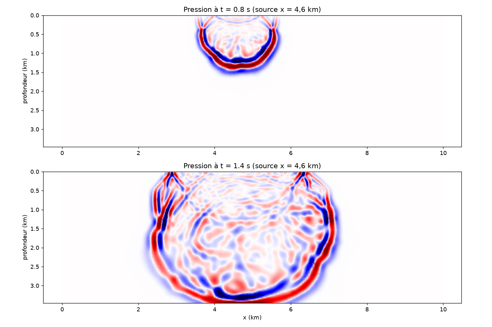
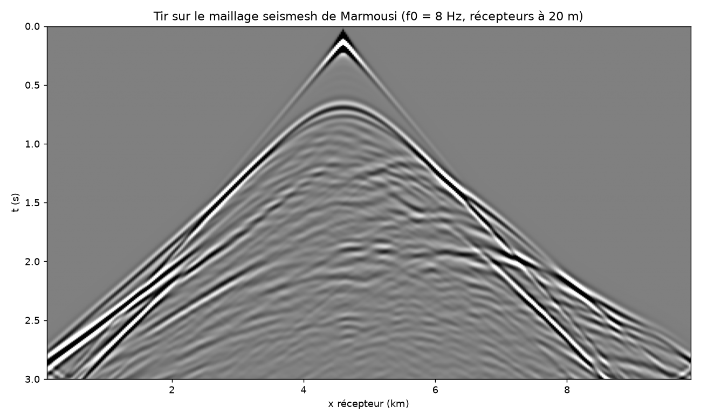
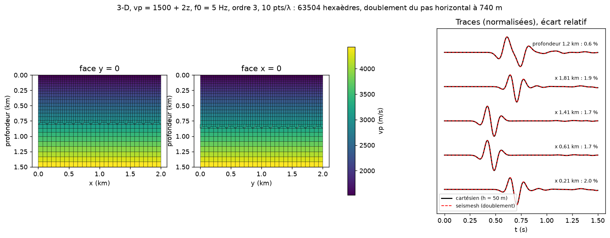
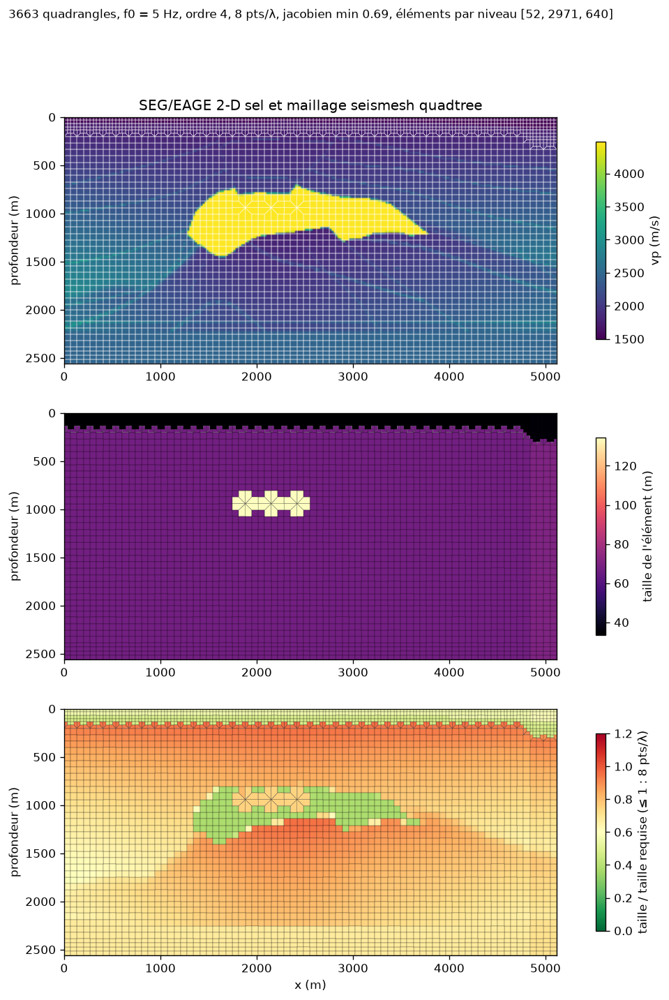
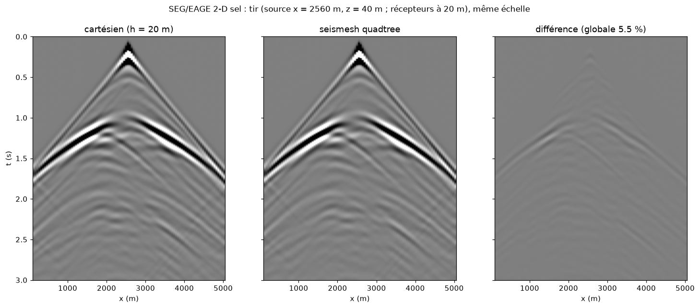

Mesh and model
##############

The meshes are Cartesian grids of spectral elements (quadrilaterals in 2-D, hexahedra in
3-D) of order 1 to the order compiled in FUnTiDES, with Gauss-Lobatto-Legendre (GLL)
points. The model (velocity, density) is constant per element (:code:`ONELEMENTS`) or
given on the nodes.

From a SEP model
================

:func:`makutu.mesh.mesh_from_sep` reads the SEP file, chooses the element size and the time
step for the source frequency, and builds the mesh:

.. code-block:: python

    from makutu.mesh import mesh_from_sep

    m = mesh_from_sep("Vp_xz.H", f0=8.0, order=4, rho_file="Rho_xz.H", ppw=6, cfl=0.3)
    m.mesh, m.dt, m.counts, m.lambda_min     # mesh, time step, element counts, shortest wavelength

- shortest wavelength of the Ricker wavelet: lambda_min = vp_min / (2.5 f0);
- element size h = order * lambda_min / ppw (GLL points per wavelength), or
  :code:`elem_size`;
- dt = cfl * smallest GLL spacing / vp_max (:func:`makutu.mesh.suggest_mesh`).

The model of an element is the SEP sample that contains its centre
(:func:`makutu.mesh.sample_sep_2d`); elements smaller than the SEP sampling are fine.

Classes
=======

- :class:`makutu.mesh.CartesianMesh2D` (2-D, FUnTiDES built with :code:`COMPILE_SEM_2D`):
  :code:`CartesianMesh2D(lx, lz, ex, ez, order, vp=..., rho=..., vp_file=..., free_surface_on_top=True)`;
- :class:`makutu.mesh.StructuredMesh` (3-D), with an optional MPI communicator for the
  domain decomposition along x.

:code:`mesh.solver_kwargs()` gives the arguments of the solvers (model, order, domain,
element counts, Kokkos views of the model). The top of the mesh is a free surface by
default; the other sides have the absorbing (paraxial) condition of FUnTiDES.

Gmsh meshes
===========

:class:`makutu.mesh.GmshMesh` reads a Gmsh mesh through the FUnTiDES readers: linear
quadrilaterals Q4 of the (x, z) plane in 2-D, hexahedra Hex8 in 3-D, any shape (not only a
grid). The GLL nodes are built at the solver order. A file in another format than MSH 2.2
ASCII is converted on reading (:code:`gmsh` Python module).

.. code-block:: python

    from makutu.mesh import GmshMesh
    mesh = GmshMesh("model.msh", order=2,
                    materials={10: (1500.0, 1000.0), 20: (3000.0, 2200.0)},   # tag: (vp, rho)
                    boundaries={1: "surface", 2: "damping"})                  # optional
    solver = AcousticSolver(implem_type=..., mesh_type=FTSolver.MeshType.UNSTRUCT,
                            dt=..., maxTime=..., **mesh.solver_kwargs())

- Each cell physical group is one material; :code:`materials` can also be a CSV file
  :code:`physical_tag,vp,rho`.
- Each boundary group (lines in 2-D, surfaces in 3-D) is a free surface or absorbing; without
  :code:`boundaries`, a group whose name contains "free" or "surface" is a free surface, any
  other one absorbing. Every outer face must be in a boundary group.
- Coordinates: makutu depth z (down) is placed at the mesh height :code:`mesh.top - z`
  (:code:`top`: highest node). Sources and receivers are located in their element by
  inverting its bilinear / trilinear map (point sources and receivers with Lagrange weights).
- Distorted elements need a smaller time step than a grid of the same size.
- Modelling only for now: the gradient, the conditioning and the model updates of the FWI
  assume a Cartesian grid.

Tools (:code:`apps/mesh/gmsh_mesh.py`): :code:`convert` (to MSH 2.2), :code:`box` (Hex8
box, structured or not), :code:`rectangle` (2-D Q4 rectangle), :code:`info`.

Meshes adapted to the model (seismesh)
======================================

:mod:`makutu.mesh.seismesh` builds a mesh whose element size follows a SEP velocity model and the
source frequency: :code:`h = order v / (f_max ppw)` with :code:`f_max = 2.5 f0` for a Ricker
wavelet of peak frequency f0. Quadrilaterals in 2-D (tensor grid, 2:1 doubling layers),
hexahedra in 3-D (also hybrid local 3-refinement and extruded unstructured quadrilaterals). The
candidates are evaluated (sampling, jacobian, CFL time step, cost) and the cheapest valid one is
written for the FUnTiDES readers, with one material class per element.

.. code-block:: bash

In 2-D the :code:`quadtree` strategy starts from the fastest velocity: a coarse grid of blocks
sized for the largest required element, then 2:1 refinement wherever the velocity is lower, with
conforming transitions (doubling and corner templates). Fast bodies such as salt keep large
elements, slow zones (water) get small ones. As in makutu, a SEP sample stands for the cell
[o + i d, o + (i + 1) d): the meshed domain is [o, o + n d]; the velocity of an element is its
area-weighted mean slowness.

    python apps/mesh/seismesh_from_sep.py --vp-file vp.H --f0 8 --order 4 --ppw 5 --out mesh_dir

.. code-block:: python

    from makutu.mesh import GmshMesh
    mesh = GmshMesh("mesh_dir/mesh.msh", 4, "mesh_dir/materials.csv")
    solver = AcousticSolver(..., mesh_type=FTSolver.MeshType.UNSTRUCT, **mesh.solver_kwargs())

Shots on doubling meshes agree with the Cartesian makutu mesh of the same model within 3.3 %
(2-D) and 2.5 % (3-D) at 10 points per wavelength. Element faces follow the sharp horizontal
interfaces of the model (midway between the samples); an element across a dipping or curved
interface (inclusion) gets the mean slowness of its samples. See
:code:`makutu/mesh/seismesh/README.md`.

   Marmousi, f0 = 8 Hz, order 4, 5 points per wavelength: 6 888 quadrilaterals; the horizontal
   step doubles at 2.26 km and is refined again at 2.84 km above slower layers
   (:code:`apps/mesh/examples/seismesh_marmousi.py`).

   Conforming 2:1 transition layers (6 quadrilaterals for 4 fine cells), no hanging node.

   Pressure on the Marmousi seismesh mesh (source at x = 4.6 km, 20 m deep).

   Shot gather on the same mesh (receivers 20 m deep, every 25 m).

   3-D, vp = 1500 + 2z: hexahedra with a doubling layer at 740 m (faces y = 0 and x = 0) and
   traces against the Cartesian makutu mesh (h = 50 m): relative differences 0.6 to 2 %.

   SEG/EAGE 2-D salt model, :code:`quadtree` mesh from the fastest velocity (f0 = 5 Hz, order 4,
   8 points per wavelength): 3 663 quadrilaterals, 134 m in the salt, 67 m in the sediments, 34 m in
   the water; element size and size / required size (at most 1 everywhere).

   Shot on the 16 points per wavelength mesh against the Cartesian makutu mesh (20 m): 5.5 % global
   difference (15 % at 8 points per wavelength): the mesh converges to the reference.

